# GCS Multi-Region DR and Lifecycle Governance

Terraform-managed Google Cloud Storage archive for a fictional fintech. Documents tier from
Standard to Nearline to Coldline by age, replicate to a second region, and are encrypted with
customer-managed keys that new writes cannot bypass. An integrity audit, access logs in BigQuery
and Prometheus cost alerts check that it all keeps working.

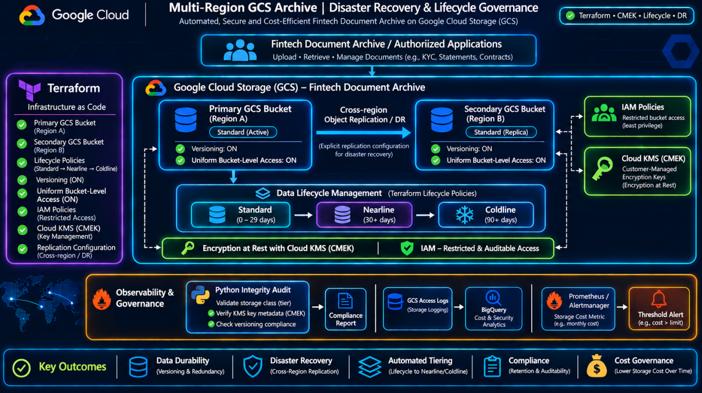

## What it does

| Area | Implementation |
|---|---|
| Storage | Primary bucket in `us-central1`, secondary in `us-east1`. Versioning, uniform bucket-level access, public access prevention, 7-day soft delete |
| Lifecycle | `STANDARD` to `NEARLINE` at 30 days, `COLDLINE` at 90 days, live versions only. Noncurrent versions deleted after 90 days |
| Encryption | One Cloud KMS key per region, 90-day rotation, `prevent_destroy`. Buckets refuse Google-managed and customer-supplied encryption |
| Replication | Storage Transfer Service cross-bucket replication, primary to secondary |
| Audit | Python audit of encryption, key state, storage class vs age, checksums and replicas, run as a read-only service account |
| Access logs | Data Access audit logs routed to BigQuery, with security and cost queries |
| Cost alerting | Prometheus exporter for estimated storage cost, Alertmanager alerts |

## Evidence

**Two buckets, two regions**

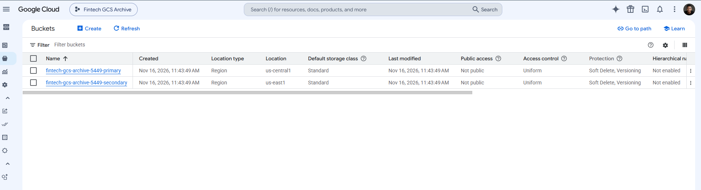

**Lifecycle rules on the primary bucket**

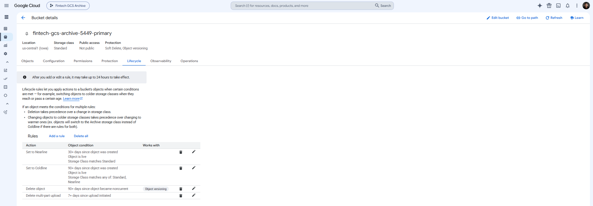

**A KMS key ring in each bucket's region**, because a CMEK key must share its bucket's location.

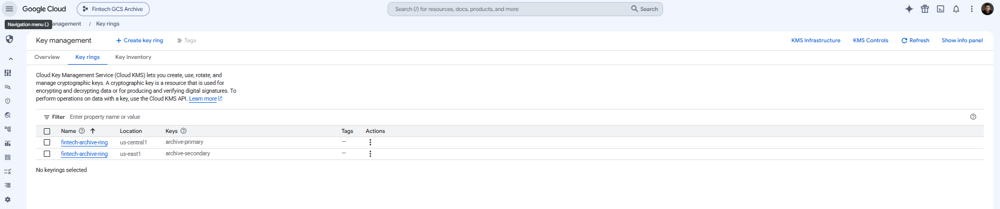

**Replicated objects in the secondary bucket, encrypted with its own key**

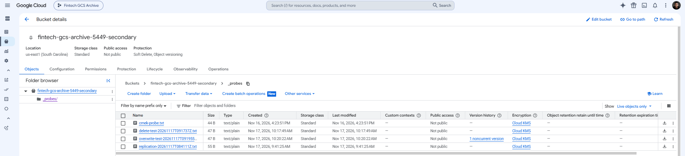

**DR scenarios:** an object deleted in the primary survives in the secondary, and a corrupted
overwrite can be restored from the secondary's version history.

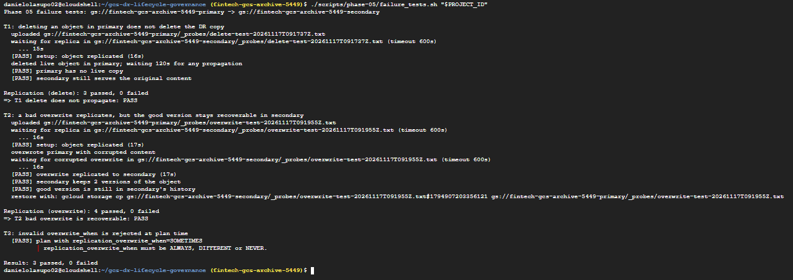

**Integrity audit as the read-only auditor:** 19 objects, every one CMEK-encrypted with its
region's key and in the right storage class for its age.

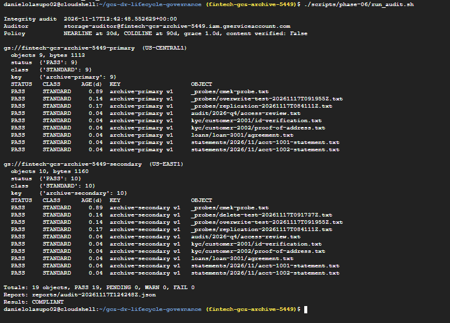

**Final configuration matches the deployment**

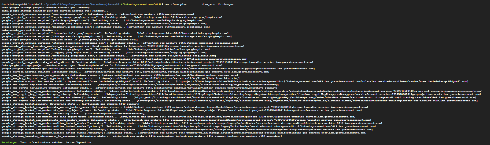

**Recovery drills:** console drift reverted by Terraform, primary restored from the secondary
region, and a document rolled back to version 1.

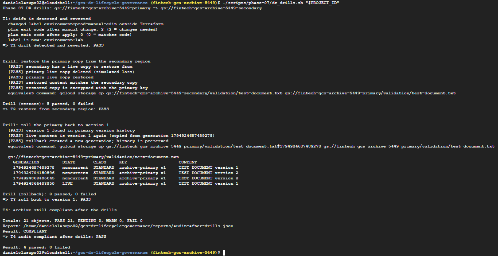

**Refused and failed requests, found with SQL in BigQuery**

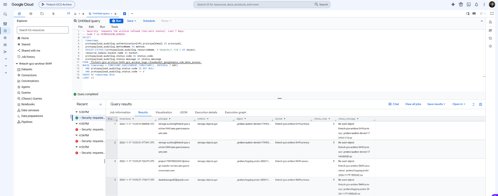

**Cost alerting pipeline**

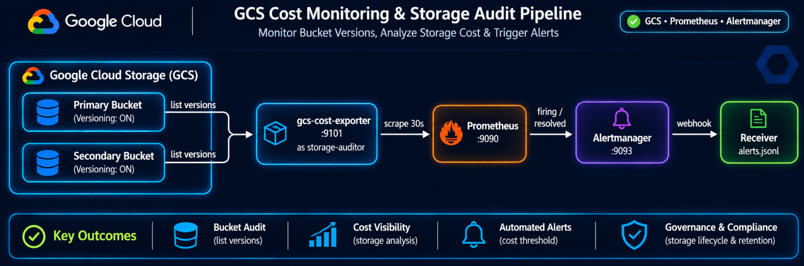

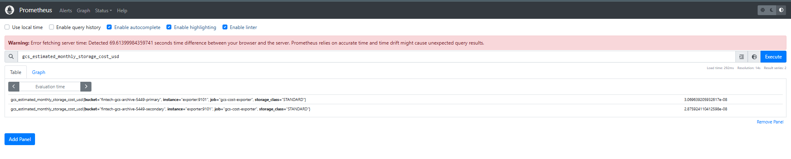

**Cost alert firing in Alertmanager**, forced by lowering the threshold, then resolved.

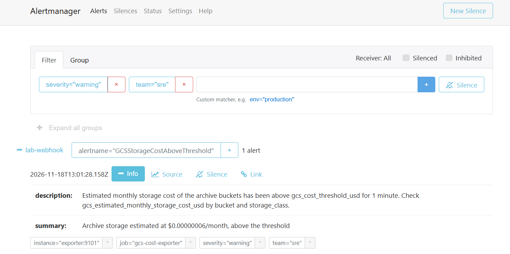

## Phases

Each phase has its own write-up with configuration, verification results, issues hit and
decisions.

| # | Phase | Doc |
|---|---|---|
| 1 | Environment setup: project, APIs, auth, $10 budget | [01](docs/01-environment-setup.md) |
| 2 | Primary and secondary buckets | [02](docs/02-bucket-infrastructure.md) |
| 3 | Lifecycle policies with day-by-day simulation | [03](docs/03-lifecycle-policies.md) |
| 4 | CMEK encryption and enforcement | [04](docs/04-cmek-encryption.md) |
| 5 | Cross-region replication and DR scenarios | [05](docs/05-cross-region-replication.md) |
| 6 | Integrity audit as a read-only identity | [06](docs/06-integrity-audit.md) |
| 7 | Final deployment, validation and recovery drills | [07](docs/07-deploy-and-validate.md) |
| 8 | Access logs in BigQuery (stretch) | [08](docs/08-access-logs-bigquery.md) |
| 9 | Cost alerting with Prometheus (stretch) | [09](docs/09-cost-alerting-prometheus.md) |

Every phase has a `verify_*.sh` script that checks the live deployment and a `failure_tests.sh`
that proves the controls refuse what they should.

## Repository layout

```
terraform/phase-01 ... phase-08   Terraform per phase; phase-08 is the final configuration
scripts/phase-01 ... phase-09     Setup, verification and failure tests; phase-09 holds the Prometheus stack
docs/                             One write-up per phase
screenshots/                      Evidence, numbered 01 to 36, plus architecture diagrams
```

## Quick start

```bash
./scripts/phase-01/create-project.sh
export PROJECT_ID=<printed project id>
HEADLESS=1 ./scripts/phase-01/setup_env.sh "$PROJECT_ID"

cd terraform/phase-08
cp terraform.tfvars.example terraform.tfvars   # set project_id and auditor_impersonators
terraform init && terraform apply
cd ../..

./scripts/phase-07/verify_deployment.sh "$PROJECT_ID"
./scripts/phase-08/verify_logging.sh "$PROJECT_ID"
./scripts/phase-09/start_stack.sh && sleep 90 && ./scripts/phase-09/verify_alerting.sh
```

## Key decisions

- **Regional buckets, regional keys.** A CMEK key must be in its bucket's location.
- **Replication through Storage Transfer Service.** The bucket resource has no replication setting; a replication job keeps two independent buckets.
- **Deletes do not replicate.** The secondary doubles as a recovery copy.
- **CMEK enforced, not just defaulted.** New objects cannot use any other encryption.
- **`prevent_destroy` on keys.** Destroying a key makes its data unreadable.
- **Audit as a separate identity.** The auditor can read metadata, key state and logs, and change nothing.
- **No long-lived service account keys.** Application Default Credentials for setup, short-lived impersonation for the audit.

## Stretch goals

| Goal | Status |
|---|---|
| Python integrity audit | Done, Phase 6 |
| Access logs in BigQuery for cost and security | Done, Phase 8 |
| Prometheus/Alertmanager cost alert | Done, Phase 9 |

## Cost

A few cents a month at lab volumes, mostly KMS key versions. Two layers of cost alerting: a $10
Cloud Billing budget at 50%, 90% and 100% for billed spend, and a Prometheus alert on estimated
storage cost against the same $10, within minutes of data changing.

## Teardown

```bash
./scripts/phase-07/teardown.sh --yes-destroy "$PROJECT_ID"
```

Deletes buckets, replication, logging and IAM, and schedules key versions for destruction. Key
rings remain, because Cloud KMS never deletes them. Deleting the project removes everything.