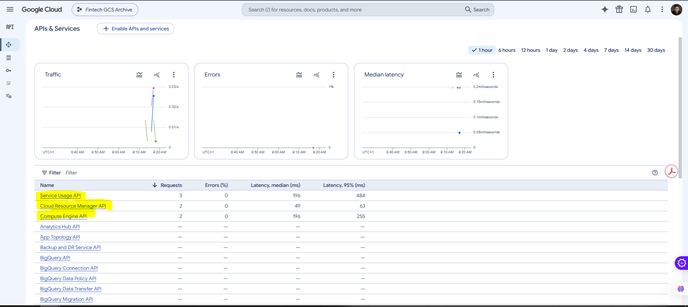
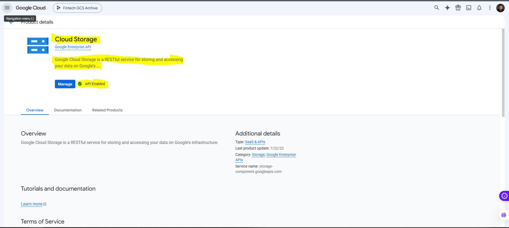
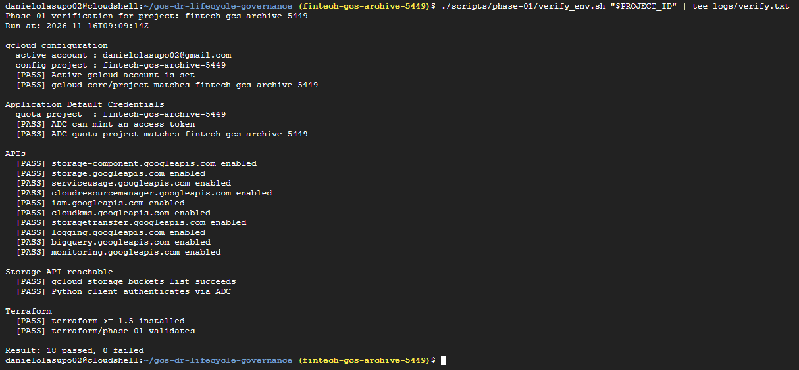
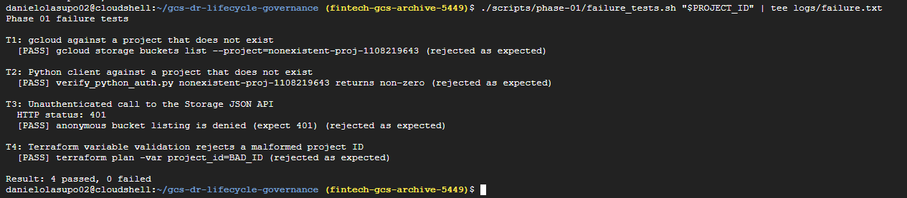

# Phase 1: Account and Environment Setup

## Objective
Prepare a Google Cloud project for the fintech document archive, enable every
API the seven phases depend on, authenticate gcloud, Terraform and Python on the
local machine, and prove all three can reach Cloud Storage before any bucket,
key or replication job is created.

## What Was Built
- A Google Cloud project, `fintech-gcs-archive-5449`, linked to an open billing account
- Cloud Storage, KMS, Storage Transfer, IAM, Resource Manager, Logging, BigQuery and Monitoring APIs enabled
- gcloud CLI and Application Default Credentials (ADC) authenticated, with the ADC quota project set to `fintech-gcs-archive-5449`
- API enablement declared in Terraform, so a disabled API shows up as drift
- A Python virtual environment with `google-cloud-storage` and `google-cloud-kms`
- A verification script with 18 checks and a failure test script with 4 negative tests
- A billing budget scoped to this project with alerts at 50%, 90% and 100%

## Configuration

### Project

| Item | Value |
|---|---|
| Project name | `Fintech GCS Archive` |
| Project ID | `fintech-gcs-archive-5449` |
| Project number | `739954060041` |
| Default region | `us-central1` |
| Working environment | Google Cloud Shell |

### Enabled APIs

| API | Purpose |
|---|---|
| `storage-component.googleapis.com` | Cloud Storage, named in the brief |
| `storage.googleapis.com` | Cloud Storage JSON API, which Terraform and the Python client call |
| `serviceusage.googleapis.com` | Lets Terraform manage API enablement |
| `cloudresourcemanager.googleapis.com` | Project lookups from Terraform (`data "google_project"`) |
| `iam.googleapis.com` | IAM binding for the Cloud Storage service agent on the KMS key (Phase 4) |
| `cloudkms.googleapis.com` | Key ring and crypto key for CMEK (Phase 4) |
| `storagetransfer.googleapis.com` | Cross-bucket replication between primary and secondary (Phase 5) |
| `logging.googleapis.com` | Bucket access logs (stretch goal) |
| `bigquery.googleapis.com` | Access log analysis dataset (stretch goal) |
| `monitoring.googleapis.com` | Storage metrics for cost alerting (stretch goal) |

### Authentication

| Item | Value |
|---|---|
| gcloud account | `Personal Google account (owner)` |
| Terraform and Python credentials | Application Default Credentials (`gcloud auth application-default login`) |
| ADC file | `~/.config/gcloud/application_default_credentials.json` (never in the repo) |
| ADC quota project | `fintech-gcs-archive-5449` |
| Cloud Storage service agent | `service-739954060041@gs-project-accounts.iam.gserviceaccount.com` |

**Why two logins?** `gcloud auth login` only authenticates the gcloud CLI.
Terraform and the Python client libraries never read those credentials; they
read ADC. If gcloud works but Terraform reports `could not find default
credentials`, the second login was skipped.

**Why set a quota project?** Without one, client library calls can bill quota
against a Google-owned project and fail with a 403 that looks like a missing
IAM role. `gcloud auth application-default set-quota-project` points quota at
this project instead.

**Why record the service agent now?** Cloud Storage encrypts with CMEK using
its own Google-managed service agent, not my account. In Phase 4 that agent
needs `roles/cloudkms.cryptoKeyEncrypterDecrypter` on the key, or every write
fails. Terraform outputs the email in Phase 1 so it is ready.

### Terraform

| Item | Value |
|---|---|
| Terraform version | `1.10.5` (installed to `~/bin`) |
| Required version | `>= 1.5` |
| Google provider | `hashicorp/google` `>= 6.0, < 8.0` |
| Provider inputs | `project_id`, `region_primary` |
| Local values file | `terraform/phase-01/terraform.tfvars` (gitignored; `.example` committed) |
| State | Local for Phase 1 |

**Why manage APIs in Terraform when the script already enabled them?** Terraform
needs `serviceusage.googleapis.com` on before it can manage anything, so the
script enables the APIs first. Terraform then adopts them into state, which
makes the API list declared in code and shows drift if someone switches one off
in the console.

**Why `disable_on_destroy = false`?** A `terraform destroy` on this config must
never be able to turn off Cloud Storage for a project holding archive data.

**Why validate `project_id`?** A typo in the project ID otherwise surfaces as a
vague 403 or 404 several API calls later. The validation block rejects it at
plan time.

### Cost guardrails

| Item | Value |
|---|---|
| Budget amount | $10 USD |
| Scope | `fintech-gcs-archive-5449` only |
| Alert thresholds | 50%, 90%, 100% |

Phase 1 resources (project, API enablement, local tooling) cost nothing.
Billable resources start in Phase 2 with storage, then Phase 4 adds KMS key
versions and Phase 5 adds transfer and inter-region egress. KMS key rings
cannot be deleted once created, and key versions only schedule destruction, so
key names are chosen once and not churned.

### Commands
The full command set is in [`scripts/phase-01/`](../scripts/phase-01/):

| Script | What it does |
|---|---|
| [`create-project.sh`](../scripts/phase-01/create-project.sh) | Creates the project with a random four-digit suffix, labels it, links it to an open billing account and sets it as the gcloud default |
| [`setup_env.sh`](../scripts/phase-01/setup_env.sh) | Checks tooling, logs in gcloud and ADC, sets project and quota project, checks billing, enables APIs, builds the Python venv |
| [`apis.txt`](../scripts/phase-01/apis.txt) | Single list of APIs used across all seven phases |
| [`create-budget.sh`](../scripts/phase-01/create-budget.sh) | Creates a $10 project-scoped budget with 50/90/100% alerts; skips if it already exists |
| [`verify_env.sh`](../scripts/phase-01/verify_env.sh) | Runs every check in the table below, plus `terraform validate` |
| [`verify_python_auth.py`](../scripts/phase-01/verify_python_auth.py) | Proves `google-cloud-storage` authenticates through ADC |
| [`failure_tests.sh`](../scripts/phase-01/failure_tests.sh) | Bad project ID, anonymous access and invalid Terraform input, each expected to fail |

Terraform for this phase is in [`terraform/phase-01/`](../terraform/phase-01/).

## Verification

| Check | Command | Result |
|---|---|---|
| Active account | `gcloud auth list --filter=status:ACTIVE --format="value(account)"` | `danielolasupo02@gmail.com` |
| Active project | `gcloud config get-value project` | `fintech-gcs-archive-5449` |
| Billing enabled | `gcloud billing projects describe fintech-gcs-archive-5449` | `billingEnabled: true` |
| Storage API enabled | `gcloud services list --enabled --filter="config.name=storage-component.googleapis.com"` | `storage-component.googleapis.com` |
| All 10 APIs enabled | `./scripts/phase-01/verify_env.sh fintech-gcs-archive-5449` | 10 API checks pass |
| ADC works | `gcloud auth application-default print-access-token` | Token printed |
| ADC quota project | `verify_env.sh` (reads the ADC file) | `fintech-gcs-archive-5449` |
| Storage reachable from gcloud | `gcloud storage buckets list --project=fintech-gcs-archive-5449` | Exit 0 |
| Storage reachable from Python | `.venv/bin/python scripts/phase-01/verify_python_auth.py fintech-gcs-archive-5449` | `[PASS] Storage API reachable` |
| Terraform authenticates | `terraform -chdir=terraform/phase-01 plan` | `No changes. Your infrastructure matches the configuration.` |
| Full check | `./scripts/phase-01/verify_env.sh fintech-gcs-archive-5449` | `Result: 18 passed, 0 failed` |
| Negative tests | `./scripts/phase-01/failure_tests.sh fintech-gcs-archive-5449` | `Result: 4 passed, 0 failed` |

The four negative tests:

| Test | Expected behaviour |
|---|---|
| T1 | gcloud rejects a project that does not exist |
| T2 | The Python client returns a clean `[FAIL]` and non-zero exit, not a stack trace |
| T3 | An anonymous call to the Storage JSON API returns HTTP 401 |
| T4 | Terraform rejects `project_id=BAD_ID` at plan time via the validation block |

### Screenshots

**Enabled APIs**


**Cloud Storage API enabled**


**Environment verification passes**


**Failure tests pass**


| File | Capture | Link |
|---|---|---|
| `01-enabled-apis.png` | APIs dashboard with Cloud Storage, Cloud KMS and Storage Transfer in the enabled list | https://console.cloud.google.com/apis/dashboard?project=fintech-gcs-archive-5449 |
| `02-storage-api-enabled.png` | Cloud Storage API page showing "API Enabled" | https://console.cloud.google.com/apis/library/storage-component.googleapis.com?project=fintech-gcs-archive-5449 |
| `03-verify-env-pass.png` | Terminal: `verify_env.sh` from the account and project lines down to `0 failed` | Terminal |
| `04-failure-tests-pass.png` | Terminal: `failure_tests.sh` with T3's `HTTP status: 401` visible | Terminal |

## Notes & Issues

### Issue: budget script missing after upload
**Symptom**
```
-bash: ./scripts/phase-01/create-budget.sh: No such file or directory
```

**Cause:** The zip unzipped in Cloud Shell was an older build of the repo,
made before `create-budget.sh` was added. Cloud Shell keeps an existing file
when a new upload has the same name, so the stale zip was the one extracted.
The project had already been created by then, so the gap only showed up one
script later.

**Fix:** Recreated the script in place with a heredoc instead of re-uploading,
then ran it:
```bash
cat > scripts/phase-01/create-budget.sh <<'EOF'
# ... script body ...
EOF
chmod +x scripts/phase-01/create-budget.sh
./scripts/phase-01/create-budget.sh "$PROJECT_ID" 10
```

**Lesson:** Same failure as the batch fleet project, which means it is a habit
problem, not a one-off. Give every upload a unique name (`gcs-v2.zip`), and run
`ls scripts/phase-01` right after unzipping to compare against the expected
file list before running anything.

## Decisions

### Decision: dedicated project with a random suffix
Project IDs are global across every Google Cloud customer and cannot be changed
after creation. `create-project.sh` adds a four-digit suffix so the ID is almost
certainly free on the first try, and a dedicated project means the budget, IAM
and teardown cover this archive and nothing else.

### Decision: every API enabled in Phase 1
The brief only names `storage-component.googleapis.com`, but KMS, Storage
Transfer and the stretch goal APIs are all needed later. Enabling them up front
means no phase stalls halfway on a `SERVICE_DISABLED` error.

### Decision: ADC user credentials instead of a service account key
The brief specifies `gcloud auth application-default login`, and it avoids a
long-lived JSON key sitting on disk in a project themed around banking
compliance. In production this would be impersonation of a dedicated Terraform
service account, or workload identity federation from CI.

### Decision: budget scoped to this project
A budget across all projects would mix this archive's spend with other labs.
Scoping it to one project means an alert points straight at this repo.

### Decision: bucket names will include the project ID
Bucket names are global across every Google Cloud customer. The starter
snippet's `fintech-archive-primary` is almost certainly taken, so Phase 2
suffixes names with the project ID.

### Decision: `uniform_bucket_level_access` instead of `bucket_policy_only`
The Phase 5 brief names `bucket_policy_only`, which the Google provider has
removed. Its replacement, `uniform_bucket_level_access`, is used from Phase 2.

### Decision: replication through Storage Transfer Service
`google_storage_bucket` has no replication block. Cross-region replication in
Phase 5 uses a `google_storage_transfer_job` with `replication_spec`, which is
why `storagetransfer.googleapis.com` is enabled now.

### Decision: KMS key location matches bucket location
A CMEK key must live in the same location as the bucket it encrypts: a `us`
key ring for a `US` multi-region bucket, a regional key ring for a regional
bucket. Regions are picked in Phase 2 with that constraint in mind.