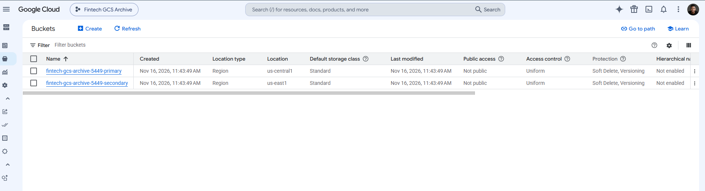
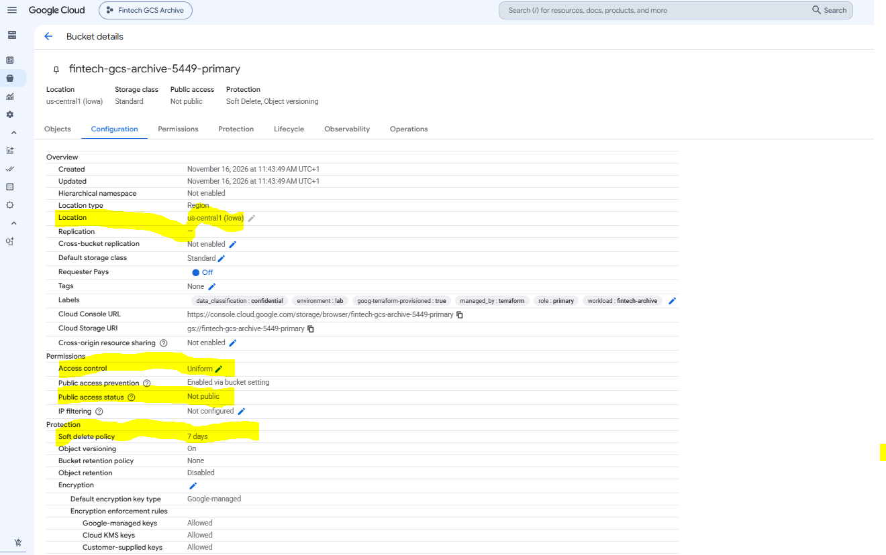
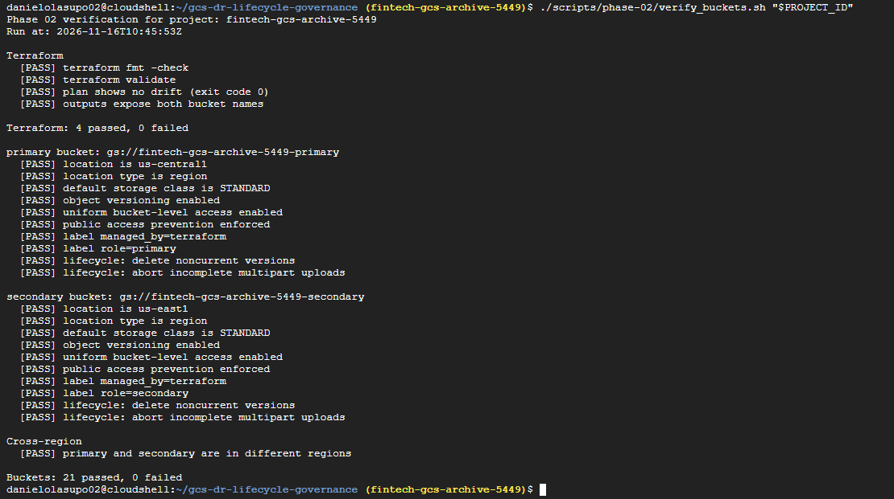
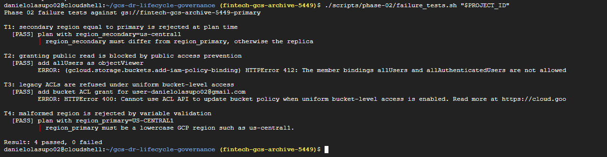

# Phase 2: Define Infrastructure as Code

## Objective
Define the primary archive bucket and the secondary disaster recovery bucket in
Terraform, in two separate regions, with versioning, uniform bucket-level access
and public access prevention on both. Region and lifecycle thresholds come from
input variables so later phases change behaviour by changing values, not code.

## What Was Built
- Primary bucket `fintech-gcs-archive-5449-primary` in `us-central1`, versioned
- Secondary bucket `fintech-gcs-archive-5449-secondary` in `us-east1`, versioned, ready for replication in Phase 5
- Uniform bucket-level access and enforced public access prevention on both buckets
- Lifecycle rules on both buckets that delete noncurrent versions after 90 days and abort stale multipart uploads after 7 days
- A 7-day soft delete window on both buckets
- Input variables for both regions and every lifecycle threshold, with validation
- A precondition that refuses to plan if both buckets are put in the same region
- Phase 1 Terraform state carried forward, so the API resources are not managed twice

## Configuration

### Buckets

| Item | Primary | Secondary |
|---|---|---|
| Name | `fintech-gcs-archive-5449-primary` | `fintech-gcs-archive-5449-secondary` |
| Location | `us-central1` (region) | `us-east1` (region) |
| Default storage class | `STANDARD` | `STANDARD` |
| Versioning | Enabled | Enabled |
| Uniform bucket-level access | Enabled | Enabled |
| Public access prevention | Enforced | Enforced |
| Soft delete | 7 days | 7 days |
| `force_destroy` | `false` | `false` |
| Labels | `workload=fintech-archive`, `data_classification=confidential`, `environment=lab`, `managed_by=terraform`, `role=primary` | Same, with `role=secondary` |

**Why two regional buckets instead of the `US` multi-region?** A multi-region
bucket already stores data in more than one place, but Google picks where and
the copy is not separately addressable. The brief asks for a secondary bucket
that replication writes into, which needs two buckets. Regional also matters
for Phase 4: a CMEK key must be in the same location as its bucket, and a
regional bucket can be paired with a regional key ring in the same region.

**Why `us-central1` and `us-east1`?** Iowa and South Carolina are roughly 1,000 km
apart and on different power grids, so one regional outage does not take out
both. Both stay in the US, which keeps data residency simple for a compliance
themed archive.

**Why enforce public access prevention?** Uniform bucket-level access stops
per-object ACLs, but IAM could still grant `allUsers`. Public access prevention
blocks that at the bucket, so a single wrong IAM binding cannot publish bank
documents. The failure tests prove both controls.

**Why version the secondary bucket too?** Replication copies whatever lands in
primary, including a bad overwrite. With versioning on the replica, the previous
version is still recoverable in the DR region.

### Lifecycle rules in this phase

| Rule | Condition | Action | Variable |
|---|---|---|---|
| Noncurrent version cleanup | 90 days after a version becomes noncurrent | Delete | `noncurrent_version_retention_days` |
| Stale upload cleanup | Multipart upload older than 7 days | AbortIncompleteMultipartUpload | `abort_incomplete_upload_days` |

These only act on old versions and unfinished uploads. Live documents are never
touched. The Standard to Nearline to Coldline transitions are added in Phase 3,
using `nearline_age_days` and `coldline_age_days`, which are declared here.

### Input variables

| Variable | Default | Validation |
|---|---|---|
| `project_id` | none | 6 to 30 chars, lowercase, starts with a letter |
| `region_primary` | `us-central1` | Lowercase region format |
| `region_secondary` | `us-east1` | Lowercase region format, and must differ from primary (precondition) |
| `nearline_age_days` | `30` | At least 1 |
| `coldline_age_days` | `90` | At least 1 |
| `noncurrent_version_retention_days` | `90` | At least 1 |
| `abort_incomplete_upload_days` | `7` | At least 1 |
| `soft_delete_retention_days` | `7` | 0, or 7 to 90 (the API's own limits) |
| `force_destroy` | `false` | none |
| `labels` | see above | none |

### Terraform

| Item | Value |
|---|---|
| Working directory | `terraform/phase-02` |
| Files | `versions.tf`, `variables.tf`, `apis.tf`, `main.tf`, `outputs.tf`, `terraform.tfvars.example` |
| State | Local, copied from `terraform/phase-01/terraform.tfstate` |
| New resources | `google_storage_bucket.primary`, `google_storage_bucket.secondary` |

**Why copy the Phase 1 state?** Each phase folder is a full snapshot of the
config, so `phase-02` also declares the ten APIs. Starting with empty state
would make Terraform think it needs to create them again. Copying the state
means the plan only shows the two new buckets. From here on, Phase 1 is not
applied again.

### Cost guardrails

Empty buckets cost nothing. Storage is billed per GB stored, and versioning and
soft delete both keep extra copies, so overwritten documents cost money until
the 90-day noncurrent rule removes them. The $10 budget from Phase 1 covers this
phase.

### Commands
The full command set is in [`scripts/phase-02/`](../scripts/phase-02/):

| Script | What it does |
|---|---|
| [`verify_buckets.sh`](../scripts/phase-02/verify_buckets.sh) | `terraform fmt -check`, `validate`, a no-drift plan, then runs the Python bucket checks |
| [`verify_buckets.py`](../scripts/phase-02/verify_buckets.py) | Reads both buckets with the client library and checks 10 settings on each, plus that they are in different regions |
| [`failure_tests.sh`](../scripts/phase-02/failure_tests.sh) | Same-region plan, public IAM grant, legacy ACL grant and a malformed region, each expected to be rejected |

## Step by Step

```bash
cd ~/gcs-dr-lifecycle-governance/terraform/phase-02
cp ../phase-01/terraform.tfstate .
cp terraform.tfvars.example terraform.tfvars
sed -i "s/your-project-id/$PROJECT_ID/" terraform.tfvars
terraform init
terraform fmt
terraform validate
terraform plan          # expect: 2 to add, 0 to change, 0 to destroy
terraform apply
terraform output
cd ~/gcs-dr-lifecycle-governance
chmod +x scripts/phase-02/*.sh
./scripts/phase-02/verify_buckets.sh "$PROJECT_ID"
./scripts/phase-02/failure_tests.sh "$PROJECT_ID"
```

## Verification

| Check | Command | Result |
|---|---|---|
| Plan adds only the buckets | `terraform plan` | `2 to add, 0 to change, 0 to destroy` |
| Both buckets exist | `gcloud storage buckets list --format="table(name,location)"` | `fintech-gcs-archive-5449-primary US-CENTRAL1`, `fintech-gcs-archive-5449-secondary US-EAST1` |
| Versioning on primary | `gcloud storage buckets describe gs://fintech-gcs-archive-5449-primary --format="value(versioning_enabled)"` | `True` |
| No drift after apply | `terraform plan -detailed-exitcode` | Exit code `0` |
| Full check | `./scripts/phase-02/verify_buckets.sh` | `Terraform: 4 passed, 0 failed` and `Buckets: 21 passed, 0 failed` |
| Negative tests | `./scripts/phase-02/failure_tests.sh` | `Result: 4 passed, 0 failed` |

The four negative tests:

| Test | Expected behaviour |
|---|---|
| T1 | Plan with `region_secondary=us-central1` fails on the precondition |
| T2 | Granting `allUsers` `roles/storage.objectViewer` fails because public access prevention is enforced |
| T3 | Adding a legacy ACL for my own account (not a public entity, so public access prevention cannot be what blocks it) fails because uniform bucket-level access is on |
| T4 | Plan with `region_primary=US-CENTRAL1` fails variable validation |

T2 and T3 run against the live primary bucket. Each test passes only if the
error message names the expected control, so an unrelated error cannot count as
a pass, and if either change unexpectedly succeeds the script reverts it.

### Screenshots

**Both buckets in separate regions**


**Primary bucket protection settings**


**Bucket verification passes**


**Public access and ACLs rejected**


| File | Capture | Link |
|---|---|---|
| `05-buckets-two-regions.png` | Buckets list showing both names with Location `us-central1` and `us-east1` | https://console.cloud.google.com/storage/browser?project=fintech-gcs-archive-5449 |
| `06-primary-bucket-protection.png` | Primary bucket Configuration tab: location `us-central1`, Public access "Not public", Access control "Uniform", object versioning on, soft delete 7 days | https://console.cloud.google.com/storage/browser/fintech-gcs-archive-5449-primary;tab=configuration?project=fintech-gcs-archive-5449 |
| `07-verify-buckets-pass.png` | Terminal: `verify_buckets.sh` from Terraform checks down to `Buckets: 21 passed, 0 failed` | Terminal |
| `08-failure-tests-pass.png` | Terminal: `failure_tests.sh` with the T2 public access prevention error visible | Terminal |

Save each as lowercase `.png`.

## Notes & Issues

### Issue: plan failed with a deleted project that is not this project
**Symptom**
```
Error: Error when reading or editing Project "fintech-gcs-archive-5449": googleapi: Error 403:
Project legacy-batch-fleet-8693 has been deleted.
  "reason": "USER_PROJECT_DENIED"
  "consumer": "projects/legacy-batch-fleet-8693"
```

**Cause:** The resources were right; the quota project was wrong. Every
Google API call names a consumer project that quota and billing are charged
to. A new Cloud Shell session opened with the old batch fleet project selected,
which had since been deleted, and that project ended up as the consumer on
every request. Google refused all of them, even though the target was
`fintech-gcs-archive-5449`.

**Fix:**
```bash
gcloud config set project fintech-gcs-archive-5449
gcloud auth application-default set-quota-project fintech-gcs-archive-5449
```
And in `versions.tf`, so the shell can never decide this again:
```hcl
provider "google" {
  billing_project       = var.project_id
  user_project_override = true
}
```

**Lesson:** The project in the Cloud Shell prompt is not just cosmetic. Check
it at the start of every session, and pin `billing_project` in the provider so
Terraform does not depend on it.

### Issue: the ACL test passed for the wrong reason
**Symptom**
```
T3: legacy ACLs are refused under uniform bucket-level access
  [PASS] add bucket ACL grant for allUsers
         ERROR: HTTPError 412: The member bindings allUsers and allAuthenticatedUsers
         are not allowed since public access prevention is enforced.
```

**Cause:** T3 was meant to prove uniform bucket-level access, but it tried to
grant the ACL to `allUsers`. Public access prevention rejects any public
entity before the ACL check runs, so T3 failed with the same 412 as T2. The
pass condition also accepted `412`, so the test reported a pass without ever
reaching the control it was named after.

**Fix:** T3 now grants the ACL to my own account, a non-public entity that
public access prevention has no objection to, and only accepts an error that
mentions uniform bucket-level access. The detail line now prints the matched
reason instead of the first error line, so each test shows which control
stopped it.

**Lesson:** A negative test is only as good as its pass condition. With two
overlapping controls, the input has to be one that only the target control
would reject, and the assertion has to check the reason, not just the failure.

### Issue: console link for the bucket page would not load
**Symptom**
```
Failed to load.
There was an error while loading /storage/browser/_details/fintech-gcs-archive-5449-primary;tab=protection
```

**Cause:** `_details` is the console path for a single object, not a bucket.

**Fix:** Bucket pages use `/storage/browser/<bucket>;tab=<tab>`. Switched the
screenshot link to the Configuration tab, which shows location, public access,
access control, versioning and soft delete on one page.

**Lesson:** Open every console link in the screenshot table once before
relying on it in a doc.

## Decisions

### Decision: bucket names derived from the project ID
The starter snippet's `fintech-archive-primary` is a global name that is almost
certainly taken. `${project_id}-primary` and `${project_id}-secondary` are unique
by construction and make it obvious which project a bucket belongs to.

### Decision: storage class transitions deferred to Phase 3
The transition thresholds are declared as variables now, but the Nearline and
Coldline rules are added in Phase 3 so each phase changes one thing and its
plan is easy to read.

### Decision: no locked retention policy
A locked bucket retention policy is the real control for regulatory retention,
but locking it is permanent: the bucket cannot be deleted until every object
ages out. For a lab project that has to be torn down, versioning, soft delete
and `force_destroy = false` give the protection without the lock.

### Decision: `force_destroy` off by default
A versioned archive should never be deletable by a routine `terraform destroy`.
It is set to `true` in `terraform.tfvars` only right before a deliberate teardown.

### Decision: same-region check as a precondition
A cross-variable check inside a `validation` block needs Terraform 1.9 or later.
A `precondition` on the secondary bucket does the same job on any version from
1.2, so the `>= 1.5` requirement stays.