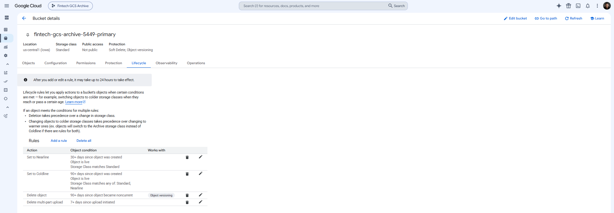
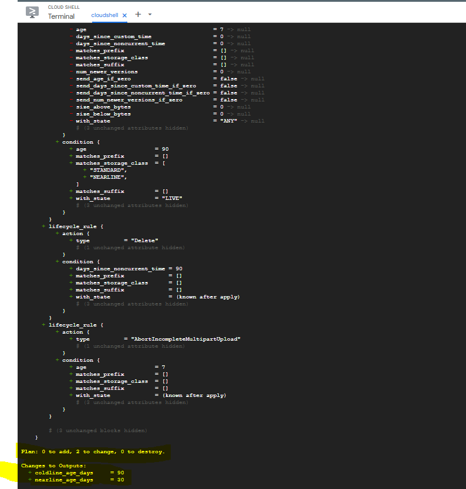
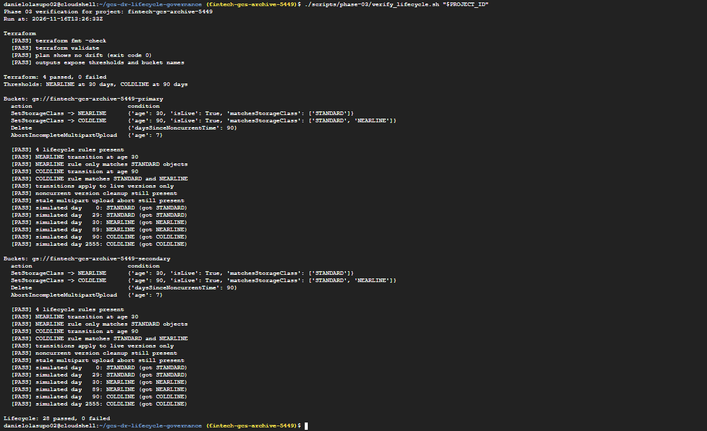
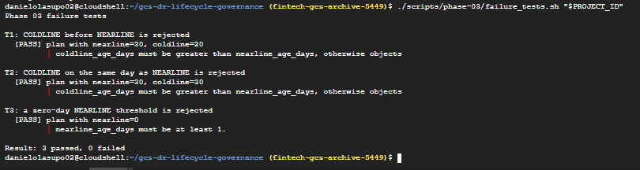

# Phase 3: Implement Lifecycle Management Policies

## Objective
Add lifecycle rules that move archive documents from Standard to Nearline after
30 days and to Coldline after 90 days, on both the primary and secondary
buckets, and prove the policy behaves as intended without waiting 90 days for
it to happen.

## What Was Built
- A `SetStorageClass` rule moving live objects from `STANDARD` to `NEARLINE` at 30 days
- A `SetStorageClass` rule moving live objects from `STANDARD` or `NEARLINE` to `COLDLINE` at 90 days
- The same four lifecycle rules on both buckets, so the DR copy is tiered like the primary
- Thresholds read from `nearline_age_days` and `coldline_age_days`, declared in Phase 2
- A precondition that refuses any plan where Coldline does not come after Nearline
- A verification script that reads the live rules and replays them day by day for a new document
- Three negative tests for invalid thresholds

## Configuration

### Lifecycle rules (both buckets)

| # | Action | Condition | Variable |
|---|---|---|---|
| 1 | SetStorageClass to `NEARLINE` | Age 30 days, class is `STANDARD`, live version | `nearline_age_days` |
| 2 | SetStorageClass to `COLDLINE` | Age 90 days, class is `STANDARD` or `NEARLINE`, live version | `coldline_age_days` |
| 3 | Delete | 90 days after a version becomes noncurrent | `noncurrent_version_retention_days` (Phase 2) |
| 4 | AbortIncompleteMultipartUpload | Upload older than 7 days | `abort_incomplete_upload_days` (Phase 2) |

**Why limit transitions to live versions?** Noncurrent versions are deleted by
rule 3. Moving one to Nearline or Coldline first would add a minimum storage
duration (30 or 90 days) to something that is about to be deleted, which only
adds an early deletion charge.

**Why does the Coldline rule also match `STANDARD`?** An object that never got
the Nearline transition, for example one uploaded before this rule existed,
should still end up in Coldline at 90 days instead of staying hot forever.
When both rules match on the same day, Cloud Storage applies the colder class.

**Why tier the secondary bucket too?** Without it, the DR replica would stay in
Standard forever and cost more than the primary it is protecting. Replicated
objects get a new creation time in the secondary bucket, so its transitions run
slightly behind the primary's. That is expected.

**Why age instead of last access?** `age` counts from upload, which is
predictable and auditable. Cloud Storage's Autoclass moves objects by access
instead, but it cannot be combined with `SetStorageClass` rules, and a
compliance archive needs a policy that can be stated in days.

### Storage class economics

US regional list prices, approximate, November 2026:

| Class | Storage (per GB per month) | Retrieval (per GB) | Minimum duration |
|---|---|---|---|
| Standard | $0.020 | $0 | None |
| Nearline | $0.010 | $0.01 | 30 days |
| Coldline | $0.004 | $0.02 | 90 days |

For 1 TB of documents kept for a year, Standard the whole time is about $240.
With these rules it is about $76: one month in Standard ($20), two in Nearline
($20) and nine in Coldline ($36). The trade-off is the retrieval fee and the
minimum duration, so this only pays off because archived statements are rarely
read after the first month.

### Terraform

| Item | Value |
|---|---|
| Working directory | `terraform/phase-03` |
| Files | `versions.tf`, `variables.tf`, `apis.tf`, `main.tf`, `outputs.tf`, `terraform.tfvars.example` |
| State | Copied from `terraform/phase-02/terraform.tfstate` |
| Changes | `google_storage_bucket.primary` and `.secondary` updated in place |
| New outputs | `nearline_age_days`, `coldline_age_days` |

**Why does the plan say "update in-place"?** Lifecycle rules are bucket
metadata. Adding them is a `PATCH` on the existing bucket, not a replacement.
If the plan ever shows `must be replaced` for a bucket, stop: replacement would
delete the bucket and everything in it.

**Why check the order with a precondition?** If `coldline_age_days` is less than
or equal to `nearline_age_days`, objects skip Nearline entirely, or both rules
fire on the same day. Neither is an error to Cloud Storage, so Terraform has to
catch it.

### Commands
The full command set is in [`scripts/phase-03/`](../scripts/phase-03/):

| Script | What it does |
|---|---|
| [`verify_lifecycle.sh`](../scripts/phase-03/verify_lifecycle.sh) | `terraform fmt -check`, `validate`, a no-drift plan, then runs the Python checks with the thresholds from Terraform outputs |
| [`verify_lifecycle.py`](../scripts/phase-03/verify_lifecycle.py) | Prints each bucket's live rules, checks 8 rule properties, and replays the rules day by day to check the class at 6 boundary days |
| [`failure_tests.sh`](../scripts/phase-03/failure_tests.sh) | Coldline before Nearline, Coldline on the same day, and a zero-day threshold, each expected to fail at plan time |

## Step by Step

```bash
cd ~/gcs-dr-lifecycle-governance/terraform/phase-03
cp ../phase-02/terraform.tfstate .
cp ../phase-02/terraform.tfvars .
terraform init
terraform fmt
terraform validate
terraform plan          # expect: 0 to add, 2 to change, 0 to destroy
terraform apply
cd ~/gcs-dr-lifecycle-governance
chmod +x scripts/phase-03/*.sh
./scripts/phase-03/verify_lifecycle.sh "$PROJECT_ID"
./scripts/phase-03/failure_tests.sh "$PROJECT_ID"
```

## Verification

| Check | Command | Result |
|---|---|---|
| Plan only updates the buckets | `terraform plan` | `0 to add, 2 to change, 0 to destroy` |
| Rules on primary | `gcloud storage buckets describe gs://fintech-gcs-archive-5449-primary --format="json(lifecycle_config)"` | 4 rules, including `SetStorageClass` to `NEARLINE` at age 30 and `COLDLINE` at age 90 |
| Rules on secondary | Same command for `gs://fintech-gcs-archive-5449-secondary` | Same 4 rules |
| No drift after apply | `terraform plan -detailed-exitcode` | Exit code `0` |
| Full check | `./scripts/phase-03/verify_lifecycle.sh` | `Terraform: 4 passed, 0 failed` and `Lifecycle: 28 passed, 0 failed` |
| Negative tests | `./scripts/phase-03/failure_tests.sh` | `Result: 3 passed, 0 failed` |

The simulated timeline for a new document, replayed from the live rules:

| Day | Expected class |
|---|---|
| 0 | STANDARD |
| 29 | STANDARD |
| 30 | NEARLINE |
| 89 | NEARLINE |
| 90 | COLDLINE |
| 2555 (7 years) | COLDLINE |

The simulation is not the real transition, which Cloud Storage runs
asynchronously, up to 24 hours after an object qualifies. It proves the rules
as written put a document in the right class on the right day. Phase 7's audit
covers what is actually stored.

The three negative tests:

| Test | Expected behaviour |
|---|---|
| T1 | Plan with `nearline_age_days=30`, `coldline_age_days=20` fails on the ordering precondition |
| T2 | Plan with both set to 30 fails on the same precondition |
| T3 | Plan with `nearline_age_days=0` fails variable validation |

### Screenshots

**Lifecycle rules on the primary bucket**


**Plan updates both buckets in place**


**Lifecycle verification and simulated timeline**


**Invalid thresholds rejected**


| File | Capture | Link |
|---|---|---|
| `09-lifecycle-rules-primary.png` | Primary bucket Lifecycle tab listing the Nearline at 30 days and Coldline at 90 days rules | https://console.cloud.google.com/storage/browser/fintech-gcs-archive-5449-primary;tab=lifecycle?project=fintech-gcs-archive-5449 |
| `10-terraform-plan-in-place.png` | Terminal: `terraform plan` showing `~ update in-place` with the new `lifecycle_rule` blocks and `0 to add, 2 to change, 0 to destroy` | Terminal |
| `11-verify-lifecycle-pass.png` | Terminal: `verify_lifecycle.sh` for the primary bucket, showing the rule table and the simulated day 29, 30, 89 and 90 lines | Terminal |
| `12-failure-tests-pass.png` | Terminal: `failure_tests.sh` with the precondition message visible | Terminal |

Save each as lowercase `.png`.

## Notes & Issues

<!--
Record each real problem hit while running this phase, in this shape:

### Issue: <short description>
**Symptom**
```
<exact error output>
```

**Cause:** <why it happened>

**Fix:**
```bash
<what was run>
```

**Lesson:** <what to do differently next time>
-->

## Decisions

### Decision: no Archive tier
Archive is cheaper again, but has a 365-day minimum duration and a higher
retrieval fee. The brief stops at Coldline, and adding Archive would be a
separate cost decision based on how often old statements are actually requested.

### Decision: no age-based deletion of live documents
Deleting a live document is a retention decision, not a cost one, and the
retention period depends on the document type and regulator. The only delete
rule is for noncurrent versions. Expiry of live records would go with a bucket
retention policy, which is out of scope for this lab (see Phase 2).

### Decision: simulate instead of waiting
Real transitions need 30 and 90 days. Shortening the thresholds to test them
would mean applying a different policy from the one being documented. Replaying
the live rules day by day tests the actual configuration, and the verification
script reads the rules from Cloud Storage rather than from the Terraform code.

### Decision: explicit rule blocks over a dynamic block
Both buckets repeat the same four `lifecycle_rule` blocks. A `dynamic` block
would remove the repetition, but explicit blocks make the plan output and the
code review match one to one, which matters more for a compliance policy than
fewer lines.