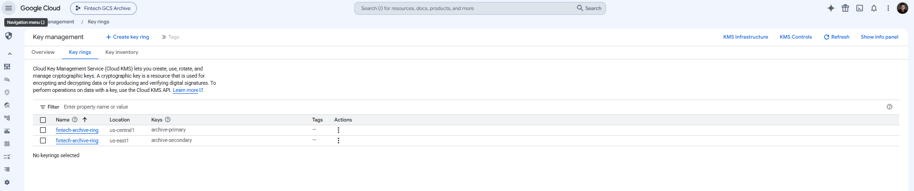
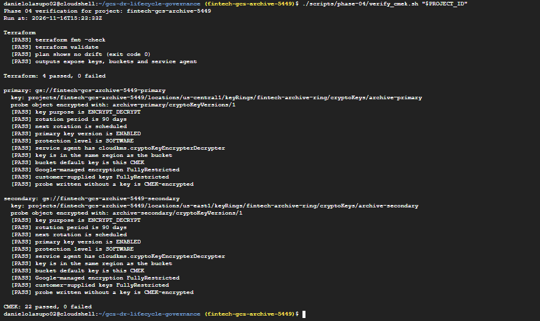
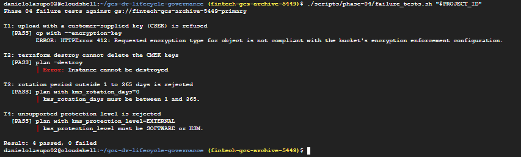

# Phase 4: Enforce Security and Encryption

## Objective
Encrypt both archive buckets with customer-managed encryption keys (CMEK) from
Cloud KMS, so the bank controls the keys rather than Google, and configure the
buckets to refuse any new object that is not CMEK-encrypted.

## What Was Built
- A key ring `fintech-archive-ring` in `us-central1` and another in `us-east1`, one per bucket region
- Crypto keys `archive-primary` and `archive-secondary`, rotating automatically every 90 days
- `roles/cloudkms.cryptoKeyEncrypterDecrypter` on each key for the Cloud Storage service agent, and nobody else
- Both buckets using their region's key as the default encryption key
- Encryption enforcement on both buckets: Google default encryption and customer-supplied keys are refused for new objects
- `prevent_destroy` on both keys, so `terraform destroy` cannot make the archive unreadable
- A verification script that writes a probe object without naming a key and confirms it was encrypted with the CMEK
- Four negative tests, including a real upload with a customer-supplied key that the bucket must refuse

## Configuration

### Keys

| Item | Primary | Secondary |
|---|---|---|
| Key ring | `fintech-archive-ring` | `fintech-archive-ring` |
| Location | `us-central1` | `us-east1` |
| Key | `archive-primary` | `archive-secondary` |
| Purpose | `ENCRYPT_DECRYPT` | `ENCRYPT_DECRYPT` |
| Algorithm | `GOOGLE_SYMMETRIC_ENCRYPTION` | `GOOGLE_SYMMETRIC_ENCRYPTION` |
| Protection level | `SOFTWARE` | `SOFTWARE` |
| Rotation period | 90 days | 90 days |
| Destroy scheduled duration | 30 days | 30 days |
| Encrypter/decrypter | Cloud Storage service agent only | Cloud Storage service agent only |

**Why two key rings?** A CMEK key must be in the same location as the bucket it
encrypts. A regional bucket in `us-central1` cannot use a key in `us` or
`us-east1`. The brief's starter snippet uses a `us` key ring, which only works
with a `US` multi-region bucket. Phase 2 chose regional buckets for exactly this
reason.

**Why grant the role to the service agent and not to me?** Cloud Storage does
the encryption, using its own Google-managed identity
(`service-739954060041@gs-project-accounts.iam.gserviceaccount.com`). Users
never touch the key directly; they read and write objects, and their access is
controlled by bucket IAM. Granting the key role to people would let them
decrypt outside Cloud Storage's access controls.

**Why 90-day rotation?** Rotation creates a new key version for new writes.
Old versions stay enabled so existing objects remain readable, which means
rotation limits how much data any single version protects without forcing a
re-encryption. 90 days lines up with common banking key management policies.

**Why `SOFTWARE` and not `HSM`?** HSM keys are FIPS 140-2 Level 3 and cost more
per version. The `kms_protection_level` variable switches to `HSM` without code
changes if a regulator requires it. Changing it on an existing key would need a
new key, because protection level is fixed per key.

### Encryption enforcement

| Encryption type | Restriction mode | Effect on new objects |
|---|---|---|
| Google-managed (default encryption) | `FullyRestricted` | Refused |
| Customer-supplied (CSEK) | `FullyRestricted` | Refused |
| Customer-managed (CMEK) | `NotRestricted` | Allowed |

**Why enforcement as well as a default key?** A default key only applies when
the writer does not name one. Without enforcement, a client could still upload
with a customer-supplied key that the bank does not hold, or the bucket could
fall back to Google-managed encryption. Enforcement makes CMEK the only option
for new objects. It does not re-encrypt objects that already exist.

**What enforcement does not do:** it allows any CMEK key, not only these two.
Restricting buckets to keys from a specific project needs the
`constraints/gcp.restrictCmekCryptoKeyProjects` organization policy, which needs
an organization. This lab project has none.

### Lifecycle protection

**Why `prevent_destroy` on the keys?** Key rings and keys can never be deleted
from Cloud KMS. Destroying a key only schedules its versions for destruction,
and after 30 days every object encrypted with them is permanently unreadable.
For an archive, that is data loss. `prevent_destroy` makes `terraform destroy`
fail instead. Teardown in Phase 7 removes the keys from state first, on purpose.

### Terraform

| Item | Value |
|---|---|
| Working directory | `terraform/phase-04` |
| Files | `versions.tf`, `variables.tf`, `apis.tf`, `kms.tf`, `main.tf`, `outputs.tf`, `terraform.tfvars.example` |
| Google provider | `>= 7.0, < 8.0` (encryption enforcement needs 7.x) |
| State | Copied from `terraform/phase-03/terraform.tfstate` |
| New resources | 2 key rings, 2 crypto keys, 2 IAM members |
| Changed resources | Both buckets, updated in place with the `encryption` block |
| New variables | `kms_key_ring_name`, `kms_rotation_days`, `kms_protection_level` |
| New outputs | `kms_key_primary`, `kms_key_secondary`, `gcs_service_agent_email` |

**Why does each bucket depend on the IAM member?** If the bucket update runs
before the service agent has the key role, Cloud Storage cannot use the key and
the update fails. `depends_on` orders them.

### Cost guardrails

A software key version costs about $0.06 a month while enabled, and every
rotation adds a version that stays enabled. Two keys rotating every 90 days add
up to roughly $3 a year after a year of rotations. Cloud Storage also calls
KMS when it reads and writes CMEK objects, billed per 10,000 operations, which
is negligible at lab volumes. The $10 budget still covers the project.

### Commands
The full command set is in [`scripts/phase-04/`](../scripts/phase-04/):

| Script | What it does |
|---|---|
| [`verify_cmek.sh`](../scripts/phase-04/verify_cmek.sh) | `terraform fmt -check`, `validate`, a no-drift plan, then runs the Python checks with keys and buckets from Terraform outputs |
| [`verify_cmek.py`](../scripts/phase-04/verify_cmek.py) | Checks each key in KMS (purpose, rotation, state, protection level, IAM), each bucket's default key and enforcement, and writes a probe object to confirm real CMEK encryption |
| [`failure_tests.sh`](../scripts/phase-04/failure_tests.sh) | CSEK upload, `plan -destroy`, invalid rotation period and invalid protection level, each expected to be rejected |

## Step by Step

```bash
cd ~/gcs-dr-lifecycle-governance/terraform/phase-04
cp ../phase-03/terraform.tfstate . && cp ../phase-03/terraform.tfvars .
terraform init
terraform fmt
terraform validate
terraform plan          # expect: 6 to add, 2 to change, 0 to destroy
terraform apply
terraform output
cd ~/gcs-dr-lifecycle-governance
chmod +x scripts/phase-04/*.sh
./scripts/phase-04/verify_cmek.sh "$PROJECT_ID"
./scripts/phase-04/failure_tests.sh "$PROJECT_ID"
```

## Verification

| Check | Command | Result |
|---|---|---|
| Plan | `terraform plan` | `6 to add, 2 to change, 0 to destroy` |
| Keys exist | `gcloud kms keys list --keyring=fintech-archive-ring --location=us-central1` | `archive-primary`, rotation `7776000s` |
| Bucket default key | `gcloud storage buckets describe gs://fintech-gcs-archive-5449-primary --format="value(default_kms_key)"` | `.../locations/us-central1/keyRings/fintech-archive-ring/cryptoKeys/archive-primary` |
| Object encryption | `gcloud storage objects describe gs://fintech-gcs-archive-5449-primary/_probes/cmek-probe.txt --format="value(kms_key)"` | `.../cryptoKeys/archive-primary/cryptoKeyVersions/1` |
| No drift after apply | `terraform plan -detailed-exitcode` | Exit code `0` |
| Full check | `./scripts/phase-04/verify_cmek.sh` | `Terraform: 4 passed, 0 failed` and `CMEK: 22 passed, 0 failed` |
| Negative tests | `./scripts/phase-04/failure_tests.sh` | `Result: 4 passed, 0 failed` |

The four negative tests:

| Test | Expected behaviour |
|---|---|
| T1 | Uploading with `--encryption-key` (a customer-supplied key) is refused by the enforcement config |
| T2 | `terraform plan -destroy` fails because the keys have `prevent_destroy` |
| T3 | Plan with `kms_rotation_days=0` fails variable validation |
| T4 | Plan with `kms_protection_level=EXTERNAL` fails variable validation |

T1 runs against the live primary bucket. If the upload ever succeeds, the
script deletes the object straight away.

### Screenshots

**CMEK keys in both regions**


**Primary bucket encrypted with CMEK**


**CMEK verification passes**


**Customer-supplied key and destroy rejected**


| File | Capture |
|---|---|
| `13-kms-keys-two-regions.png` | Key Management page listing `fintech-archive-ring` in `us-central1` and `us-east1` | 
| `14-primary-bucket-cmek.png` | Primary bucket Configuration tab showing Encryption type: Customer-managed key, with the `archive-primary` key name | 
| `15-verify-cmek-pass.png` | Terminal: `verify_cmek.sh` for the primary bucket, including the "probe object encrypted with" line | 
| `16-failure-tests-pass.png` | Terminal: `failure_tests.sh` with the T1 CSEK rejection and T2 `prevent_destroy` lines visible |


<!--
Record each real problem hit while running this phase, in this shape:

### Issue: <short description>
**Symptom**
```
<exact error output>
```

**Cause:** <why it happened>

**Fix:**
```bash
<what was run>
```

**Lesson:** <what to do differently next time>
-->

## Decisions

1. **One key per bucket, not one shared key**

   The location rule forces two keys anyway. It also means a compromise or disablement of one key affects one region only, and each key's audit log maps to one bucket.

2. **`kms.tf` separate from `main.tf`**

   The brief asks for `terraform/kms.tf`. Keeping keys in their own file also makes it obvious in review that key changes are a different risk class from bucket changes.

3. **Probe object instead of trusting the setting**

   A bucket can report a default key while writes still fail or fall back, for example if the service agent lacks the key role. Writing a real object and reading back `kms_key_name` proves the whole chain: bucket setting, IAM, KMS and the enforcement config together.

4. **No key access for human users**

   No human, including me, is granted `cryptoKeyEncrypterDecrypter`. Key administration (rotation, disabling) is done through Terraform. In this lab one person is project owner and could grant themselves the role, so the separation is by convention. In production, key administrators and key users would be separate identities, ideally with the keys in a dedicated KMS project.