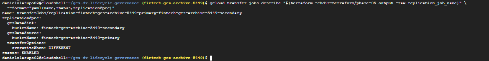
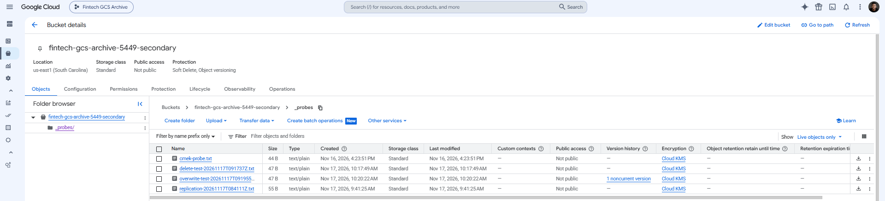
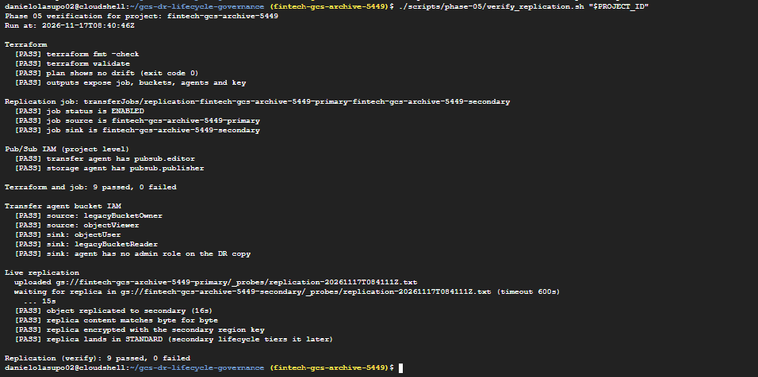
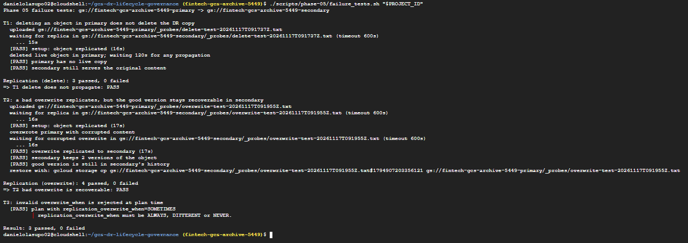

# Phase 5: Automate Cross-Region Replication

## Objective
Replicate every new or updated document from the primary bucket in `us-central1`
to the secondary bucket in `us-east1` automatically, with uniform bucket-level
access enforced on both, and prove the DR copy survives the two most common
ways data gets lost: an accidental delete and a corrupting overwrite.

## What Was Built
- A Storage Transfer Service cross-bucket replication job from primary to secondary
- Least-privilege bucket roles for the Storage Transfer Service agent on each bucket
- Pub/Sub roles for change notifications: Pub/Sub Editor for the transfer agent, Pub/Sub Publisher for the Cloud Storage agent
- The Pub/Sub API added to the managed API list
- Uniform bucket-level access confirmed on both buckets (set since Phase 2)
- A live verification that uploads a probe and times how long it takes to land in secondary
- Two DR scenarios run against the real buckets: a delete and a bad overwrite

## Configuration

### Replication job

| Item | Value |
|---|---|
| Type | Storage Transfer Service cross-bucket replication (`replication_spec`) |
| Name | Google-assigned `transferJobs/<id>` (custom names are not supported) |
| Source | `fintech-gcs-archive-5449-primary` (`us-central1`) |
| Sink | `fintech-gcs-archive-5449-secondary` (`us-east1`) |
| Trigger | Pub/Sub notification on every new or updated object in source |
| Overwrite | `DIFFERENT` (overwrite the replica only when the object changed) |
| Status | `ENABLED` |

**Why Storage Transfer Service and not a bucket setting?** `google_storage_bucket`
has no replication block. Google's own built-in replication (dual-region and
turbo replication) keeps one bucket in two places. The brief asks for two
separate buckets with their own settings, which is what cross-bucket
replication does: each bucket keeps its own location, CMEK key, lifecycle rules
and IAM.

### What replication does and does not copy

| Event in primary | In secondary |
|---|---|
| New object | Copied |
| Object overwritten | New version copied; the previous version stays as noncurrent |
| Object deleted | **Not** deleted |
| Noncurrent versions | Not copied |
| Objects that existed before the job | Not copied |
| Lifecycle rules, timestamps | Not copied; secondary uses its own |

**Why is "deletes are not replicated" a feature here?** For DR, a replica that
mirrors deletes is only protection against a region outage, not against a
mistake or an attacker. Because deletes stop at the primary, the secondary acts
as a recovery copy too. T1 proves it.

**Why does a bad overwrite still replicate?** Replication cannot tell a
legitimate update from a corrupted one. What protects the data is versioning on
the secondary bucket (Phase 2): the replica's previous version stays available
for 90 days. T2 proves the good copy can be restored.

**Objects from before the job:** the Phase 4 CMEK probes were written before
replication existed, so they are only in their own bucket. In a real migration,
a one-time Storage Transfer job would backfill them.

### IAM for replication

| Identity | Role | Scope | Why |
|---|---|---|---|
| Storage Transfer agent | `roles/storage.legacyBucketOwner` | Primary bucket | Read bucket metadata and manage its Pub/Sub notification config |
| Storage Transfer agent | `roles/storage.objectViewer` | Primary bucket | Read objects to copy |
| Storage Transfer agent | `roles/storage.objectUser` | Secondary bucket | Write replicated objects |
| Storage Transfer agent | `roles/storage.legacyBucketReader` | Secondary bucket | Read bucket metadata |
| Storage Transfer agent | `roles/pubsub.editor` | Project | Create and consume the notification topic and subscription |
| Cloud Storage agent | `roles/pubsub.publisher` | Project | Publish object change events |

**Why bucket-level roles and not project-level Storage Admin?** Storage Admin
on the project would let the transfer agent touch every bucket. These grants
are scoped to the two buckets in this job, and the agent has no admin role on
the DR copy.

**What about CMEK?** The transfer agent never needs the KMS keys. Cloud Storage
decrypts objects for any principal allowed to read them, and writes replicas
with the secondary bucket's default key, using its own service agent, which was
granted access to that key in Phase 4. The secondary's enforcement config
accepts these writes because they are CMEK-encrypted.

### Uniform bucket-level access

The brief names `bucket_policy_only`, the attribute's old name, which the
Google provider has removed. Both buckets have
`uniform_bucket_level_access = true` and have since Phase 2. Phase 2's T3 test
proved legacy ACLs are refused.

### Terraform

| Item | Value |
|---|---|
| Working directory | `terraform/phase-05` |
| Files | `versions.tf`, `variables.tf`, `apis.tf`, `kms.tf`, `main.tf`, `replication.tf`, `outputs.tf`, `terraform.tfvars.example` |
| State | Copied from `terraform/phase-04/terraform.tfstate` |
| New resources | Pub/Sub API, 4 bucket IAM members, 2 project IAM members, 1 transfer job |
| Changed resources | None |
| New variable | `replication_overwrite_when` (`ALWAYS`, `DIFFERENT` or `NEVER`) |
| New outputs | `replication_job_name`, `sts_service_agent_email` |

### Cost guardrails

Check the Storage Transfer Service pricing page for any per-object charge on
replication jobs. The certain costs are the copy itself: inter-region network transfer between
`us-central1` and `us-east1`, storage of the second copy, and Pub/Sub messages
per object change. At lab volumes (a few KB of probes) this is cents. At
archive scale, the second copy roughly doubles storage cost, which is the price
of the DR requirement.

### Commands
The full command set is in [`scripts/phase-05/`](../scripts/phase-05/):

| Script | What it does |
|---|---|
| [`verify_replication.sh`](../scripts/phase-05/verify_replication.sh) | Terraform checks, job status, source and sink, project Pub/Sub roles, then runs the live replication check |
| [`replication_check.py`](../scripts/phase-05/replication_check.py) | `verify`: bucket IAM plus a timed live replication. `delete` and `overwrite`: the two DR scenarios |
| [`failure_tests.sh`](../scripts/phase-05/failure_tests.sh) | Runs the delete and overwrite scenarios and an invalid `overwrite_when` plan |

## Step by Step

```bash
cd ~/gcs-dr-lifecycle-governance/terraform/phase-05
cp ../phase-04/terraform.tfstate . && cp ../phase-04/terraform.tfvars .
terraform init
terraform fmt
terraform validate
terraform plan          # expect: 8 to add, 0 to change, 0 to destroy
terraform apply
terraform output replication_job_name
cd ~/gcs-dr-lifecycle-governance
chmod +x scripts/phase-05/*.sh
sleep 120               # give the new job time to set up its Pub/Sub notification
./scripts/phase-05/verify_replication.sh "$PROJECT_ID"
./scripts/phase-05/failure_tests.sh "$PROJECT_ID"
```

## Verification

| Check | Command | Result |
|---|---|---|
| Plan | `terraform plan` | `8 to add, 0 to change, 0 to destroy` |
| Job exists | `gcloud transfer jobs list --job-type=replication` | One job, status `ENABLED` |
| Job wiring | `gcloud transfer jobs describe <job> --format="yaml(replicationSpec)"` | Source primary, sink secondary |
| No drift after apply | `terraform plan -detailed-exitcode` | Exit code `0` |
| Full check | `./scripts/phase-05/verify_replication.sh` | `Terraform and job: 9 passed, 0 failed` and `Replication (verify): 9 passed, 0 failed` |
| DR scenarios | `./scripts/phase-05/failure_tests.sh` | `Result: 3 passed, 0 failed` |

Live replication checks in `verify`:

| Check | Expected |
|---|---|
| Probe appears in secondary | Within 10 minutes, usually under 2 |
| Content | Byte for byte identical |
| Encryption | `archive-secondary` key, not the primary's |
| Storage class | `STANDARD` on arrival; the secondary's own lifecycle tiers it later |

The DR scenarios:

| Test | What happens | Expected |
|---|---|---|
| T1 | Upload, wait for replica, delete from primary, wait 2 minutes | Primary has no live copy; secondary still serves the original |
| T2 | Upload, wait for replica, overwrite primary with corrupted data, wait for that to replicate | Secondary has 2 versions; the good one is still readable, and the script prints the restore command |
| T3 | Plan with `replication_overwrite_when=SOMETIMES` | Rejected by variable validation |

### Screenshots

**Replication job enabled**


**Replicated probe in the secondary bucket**


**Live replication verified**


**DR scenarios pass**


| File | Capture | Link |
|---|---|---|
| `17-replication-job.png` | Terminal: `gcloud transfer jobs describe` output showing the job name, `status: ENABLED`, and `replicationSpec` with primary as source and secondary as sink. The Transfer jobs console page does not list cross-bucket replication jobs | Terminal |
| `18-replica-in-secondary.png` | Secondary bucket's `_probes/` folder listing the replicated `replication-*.txt` objects | https://console.cloud.google.com/storage/browser/fintech-gcs-archive-5449-secondary/_probes?project=fintech-gcs-archive-5449 |
| `19-verify-replication-pass.png` | Terminal: `verify_replication.sh` from the job checks down to "object replicated to secondary (Ns)" and the encryption line | Terminal |
| `20-dr-scenarios-pass.png` | Terminal: `failure_tests.sh` with T1 "secondary still serves the original content" and T2's restore command visible | Terminal |

Save each as lowercase `.png`.

## Notes & Issues

### Issue: replication job not visible in the console
**Symptom:** The Transfer jobs page at
`console.cloud.google.com/transfer/jobs` showed only the empty "Create
transfer job" screen after a successful `terraform apply`.

**Cause:** The console's Transfer jobs list did not show the cross-bucket
replication job. Google's own docs list replication jobs with a separate
filtered command, `gcloud alpha transfer jobs list --job-type=replication`.

**Fix:** Verified the job from the CLI instead:
```bash
gcloud transfer jobs describe "$(terraform -chdir=terraform/phase-05 output -raw replication_job_name)" \
  --format="yaml(name,status,replicationSpec)"
```
and verified the result in the console, in the secondary bucket's `_probes/`
folder.

**Lesson:** An empty console page is not proof that a resource is missing.
Check Terraform state and the API first, then judge the console.

<!--
Record each real problem hit while running this phase, in this shape:

### Issue: <short description>
**Symptom**
```
<exact error output>
```

**Cause:** <why it happened>

**Fix:**
```bash
<what was run>
```

**Lesson:** <what to do differently next time>
-->

## Decisions

### 1. One-way replication
Replication runs from primary to secondary only. Two-way replication would make the DR copy writable by the application and blur which bucket is the source of truth. Failback after a regional outage is a separate, deliberate job in the opposite direction.

### 2. `overwrite_when = DIFFERENT`
`ALWAYS` rewrites the replica even when nothing has changed, adding transfer costs and noncurrent versions. `NEVER` would leave the replica stale after a legitimate update. `DIFFERENT` only copies when the object has actually changed.

### 3. Test DR with real objects, not just configuration
A job can show `ENABLED` while notifications are broken, for example, if the Cloud Storage agent lacks Pub/Sub Publisher permissions. The live probe and two test scenarios validate the entire replication path end to end and measure actual replication time.

### 4. No RPO guarantee
Cross-bucket replication does not provide a guaranteed recovery point objective (RPO). Google states that most objects arrive within minutes, while large objects can take hours. The replication time measured by `verify` is recorded as an observation, not a guarantee. A hard RPO would require turbo replication on a dual-region bucket, which is a different design.