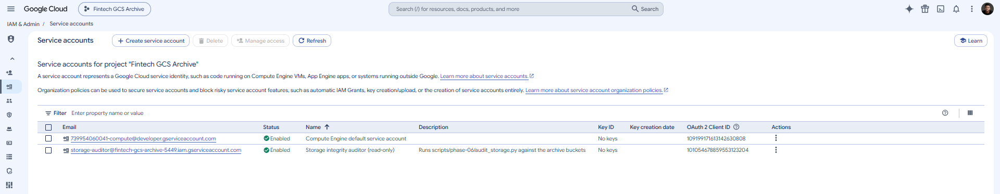
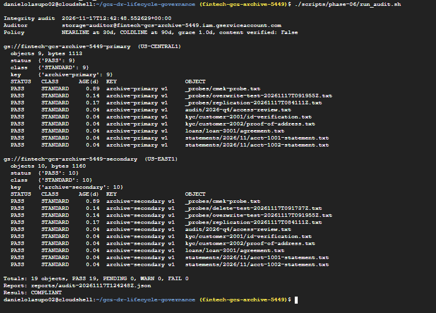
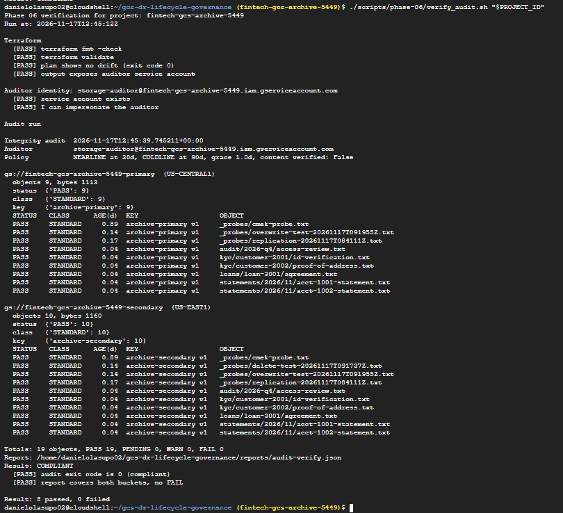
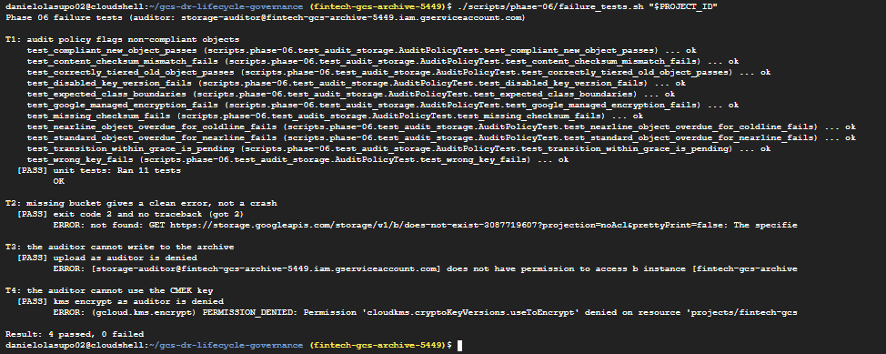

# Phase 6: Build Automated Integrity Auditing Script

## Objective
Build a Python audit that walks every object in both archive buckets and
produces a structured compliance report on encryption, storage class and
integrity, and run it as a read-only auditor identity so the audit itself
follows least privilege.

## What Was Built
- `audit_storage.py`, using `google.cloud.storage` and Cloud KMS, that checks every live object for:
  - CMEK encryption with the expected key, on a key version that is `ENABLED`
  - storage class against the 30/90-day lifecycle policy, with a grace window for asynchronous transitions
  - a recorded CRC32C checksum, and optionally that the content still matches it
  - a replica in the secondary bucket, for objects in the primary
- A JSON compliance report per run, plus a console summary and an overall COMPLIANT or NON-COMPLIANT result
- A `storage-auditor` service account with read-only bucket access and KMS viewer, run through impersonation
- Six synthetic archive documents (statements, KYC, loan, audit) so the report has realistic content
- 11 unit tests proving the audit flags every non-compliant case
- Failure tests proving the auditor can neither write to the archive nor use the keys

## Configuration

### What the audit checks

| Check | PASS | PENDING | WARN | FAIL |
|---|---|---|---|---|
| Encryption | CMEK with the bucket's expected key | | Key version state unreadable | Google-managed, or a different key |
| Key version | `ENABLED` | | | `DISABLED`, `DESTROYED` or scheduled for destruction |
| Storage class | Matches policy for the object's age | Transition due, within 1-day grace | Colder than policy | Transition overdue past grace |
| Integrity | CRC32C recorded (and matches content with `--verify-content`) | | | No checksum, or content mismatch |
| Replica (primary only) | Present in secondary, or created before the replication job | Under 15 minutes old | Missing from secondary | |

An object's status is its worst finding. The run is NON-COMPLIANT if any object
is FAIL, and the script exits `1`.

**Why check the key version state?** An object encrypted with a disabled or
destroyed key version is unreadable even though its metadata looks fine. For an
archive, that is silent data loss, and only the key state shows it.

**Why a grace window?** Cloud Storage applies lifecycle transitions
asynchronously, up to a day after an object qualifies. Without grace, every
object would flicker to FAIL on its 30th and 90th day.

**Why is `--verify-content` optional?** It downloads every object to recompute
CRC32C. On Nearline and Coldline that incurs retrieval fees, and on a large
archive it is slow. The default run checks that a checksum exists; a full
content verification is a scheduled, deliberate job.

### Report format

```json
{
  "generated_at": "2026-11-17T12:00:00+00:00",
  "auditor": "storage-auditor@fintech-gcs-archive-5449.iam.gserviceaccount.com",
  "policy": {"nearline_days": 30, "coldline_days": 90, "grace_days": 1.0, "verify_content": false},
  "buckets": [{
    "bucket": "fintech-gcs-archive-5449-primary",
    "summary": {"objects": 9, "by_status": {"PASS": 9}, "by_storage_class": {"STANDARD": 9}, "by_key": {"archive-primary": 9}},
    "objects": [{"name": "statements/2026/11/acct-1001-statement.txt", "status": "PASS", "findings": []}]
  }],
  "totals": {"objects": 18, "PASS": 18}
}
```

Reports are written to `reports/` (gitignored). The screenshots are the evidence.

### Auditor identity

| Item | Value |
|---|---|
| Service account | `storage-auditor@fintech-gcs-archive-5449.iam.gserviceaccount.com` |
| Bucket roles (both buckets) | `roles/storage.objectViewer`, `roles/storage.legacyBucketReader` |
| Key roles (both keys) | `roles/cloudkms.viewer` |
| Who can run as it | Principals in `auditor_impersonators`, via `roles/iam.serviceAccountTokenCreator` |
| How | Short-lived impersonated credentials (15 minutes); no key file |

**Why a separate identity?** Running the audit as the project owner proves
nothing about access, and a bug in the script could change data. As the
auditor, any write or key use is refused by Google, which the failure tests
prove.

**Why impersonation instead of a key?** Impersonation issues a token for 15
minutes, based on my own login. There is no long-lived JSON key to leak, which
matches the Phase 1 decision.

### Terraform

| Item | Value |
|---|---|
| Working directory | `terraform/phase-06` |
| Files | `versions.tf`, `variables.tf`, `apis.tf`, `kms.tf`, `main.tf`, `replication.tf`, `audit.tf`, `outputs.tf`, `terraform.tfvars.example` |
| State | Copied from `terraform/phase-05/terraform.tfstate` |
| New resources | `iamcredentials` API, auditor service account, 4 bucket IAM members, 2 key IAM members, 1 impersonation grant |
| Changed resources | None |
| New variable | `auditor_impersonators` |
| New output | `auditor_service_account_email` |

### Cost guardrails

The audit lists objects and reads metadata, which are cheap Class A and B
operations. Key state lookups are cached per key version. `--verify-content`
is the only expensive option, because it reads object data.

### Commands
The full command set is in [`scripts/phase-06/`](../scripts/phase-06/):

| Script | What it does |
|---|---|
| [`audit_storage.py`](../scripts/phase-06/audit_storage.py) | The audit. Writes the JSON report, prints the summary, exits 0, 1 or 2 |
| [`run_audit.sh`](../scripts/phase-06/run_audit.sh) | Runs the audit as the auditor, with buckets, keys and thresholds from Terraform outputs |
| [`seed_documents.py`](../scripts/phase-06/seed_documents.py) | Uploads six synthetic documents with `document_type` metadata |
| [`test_audit_storage.py`](../scripts/phase-06/test_audit_storage.py) | 11 unit tests for the audit policy |
| [`verify_audit.sh`](../scripts/phase-06/verify_audit.sh) | Terraform checks, auditor identity, a full audit run and report validation |
| [`failure_tests.sh`](../scripts/phase-06/failure_tests.sh) | Unit tests, missing bucket, auditor write attempt, auditor key use attempt |

## Step by Step

```bash
cd ~/gcs-dr-lifecycle-governance/terraform/phase-06
cp ../phase-05/terraform.tfstate . && cp ../phase-05/terraform.tfvars .
echo "auditor_impersonators = [\"user:$(gcloud config get-value account)\"]" >> terraform.tfvars
terraform init
terraform fmt
terraform validate
terraform plan          # expect: 9 to add, 0 to change, 0 to destroy
terraform apply
cd ~/gcs-dr-lifecycle-governance
grep -qx "reports/" .gitignore || echo "reports/" >> .gitignore
chmod +x scripts/phase-06/*.sh
.venv/bin/python scripts/phase-06/seed_documents.py "$PROJECT_ID" fintech-gcs-archive-5449-primary
sleep 180               # replication of the seeded documents, and IAM propagation
./scripts/phase-06/run_audit.sh
./scripts/phase-06/verify_audit.sh "$PROJECT_ID"
./scripts/phase-06/failure_tests.sh "$PROJECT_ID"
```

## Verification

| Check | Command | Result |
|---|---|---|
| Plan | `terraform plan` | `9 to add, 0 to change, 0 to destroy` |
| Auditor exists | `gcloud iam service-accounts list --filter=email:storage-auditor` | `storage-auditor@...` |
| Audit result | `./scripts/phase-06/run_audit.sh` | `Result: COMPLIANT`, exit code `0` |
| Full check | `./scripts/phase-06/verify_audit.sh` | `Result: 8 passed, 0 failed` |
| Negative tests | `./scripts/phase-06/failure_tests.sh` | `Result: 4 passed, 0 failed` |

The four negative tests:

| Test | What happens | Expected |
|---|---|---|
| T1 | 11 unit tests feed the policy synthetic objects: Google-managed encryption, wrong key, disabled key version, overdue transitions, missing and mismatched checksums | Every non-compliant case is FAIL; in-grace transitions are PENDING; compliant cases PASS |
| T2 | Audit a bucket that does not exist | Exit code `2`, one `ERROR:` line, no Python traceback |
| T3 | Upload to the primary bucket as the auditor | 403, permission denied |
| T4 | `gcloud kms encrypt` with the primary key as the auditor | 403, permission denied |

T1 is needed because the live buckets cannot hold a non-compliant object:
Phase 4's enforcement refuses non-CMEK writes, and nothing is old enough to be
overdue for Nearline. The unit tests prove the audit would catch those cases.

### Screenshots

**Read-only auditor service account**


**Audit report summary**


**Audit verification passes**


**Auditor denied writes and key use**


| File | Capture |
|---|---|
| `21-auditor-service-account.png` | Service accounts list showing `storage-auditor` and its description | 
| `22-audit-report-summary.png` | Terminal: `run_audit.sh` output with the auditor line, the per-object table for the primary bucket and `Result: COMPLIANT` | 
| `23-verify-audit-pass.png` | Terminal: `verify_audit.sh` from the auditor identity checks to `8 passed, 0 failed` | 
| `24-failure-tests-pass.png` | Terminal: `failure_tests.sh` with the unit test list and the T3 and T4 permission denied lines | 

Save each as lowercase `.png`.

## Notes & Issues

### Issue: every object failed with no checksum
**Symptom**
```
gs://fintech-gcs-archive-5449-primary  (US-CENTRAL1)
  status  {'FAIL': 9}
  FAIL     STANDARD     0.00  archive-primary v1     statements/2026/11/acct-1001-statement.txt
           - FAIL NO_CHECKSUM: no CRC32C recorded
...
Totals: 19 objects, PASS 0, PENDING 0, WARN 0, FAIL 19
Result: NON-COMPLIANT
```

**Cause:** The audit read each object's metadata from the bucket listing. For
these CMEK-encrypted objects, the listing returned no CRC32C. A direct lookup
of a single object did return it, both as me and as the auditor:
```bash
gcloud storage objects describe "$OBJ" --format="value(crc32c_hash)"
# rL0i7w==
gcloud storage objects describe "$OBJ" --format="value(crc32c_hash)" \
  --impersonate-service-account=storage-auditor@fintech-gcs-archive-5449.iam.gserviceaccount.com
# rL0i7w==
```
So the checksums existed and the auditor could read them. Only the list
response left them out.

**Fix:** When a listed object has no CRC32C, the audit now fetches that object
directly (`blob.reload()`) before judging it, and records where the checksum
came from in the report as `hash_source` (`list` or `get`). An object that
still has no checksum after the direct fetch still fails.

**Lesson:** An empty field in a list response is not the same as an empty
field on the object. The audit was right to fail rather than skip the check.
A version that treated a missing checksum as "nothing to verify" would have
reported COMPLIANT while verifying nothing.


## Decisions

### 1. The report is JSON, the summary is for humans
JSON can be loaded into BigQuery or diffed between runs, which the stretch goal
needs. The console summary is for whoever runs it. Both come from the same data.

### 2. Exit codes mean something
`0` compliant, `1` non-compliant, `2` could not run. A scheduler or CI job can
alert on `1` and page on `2` without parsing output.

### 3. Policy thresholds come from Terraform
`run_audit.sh` reads `nearline_age_days`, `coldline_age_days`, bucket names and
keys from Terraform outputs. If the lifecycle policy changes in code, the audit
checks against the new policy with no script edit.

### 4. No pass for objects that are merely old
An object that should be in Coldline but is still in Nearline past the grace
window is FAIL, not WARN. A lifecycle rule that has stopped working costs money
every day and usually means someone changed the bucket by hand.