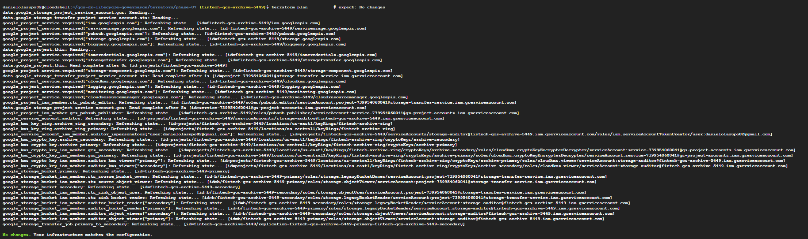
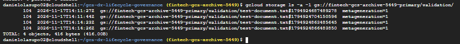
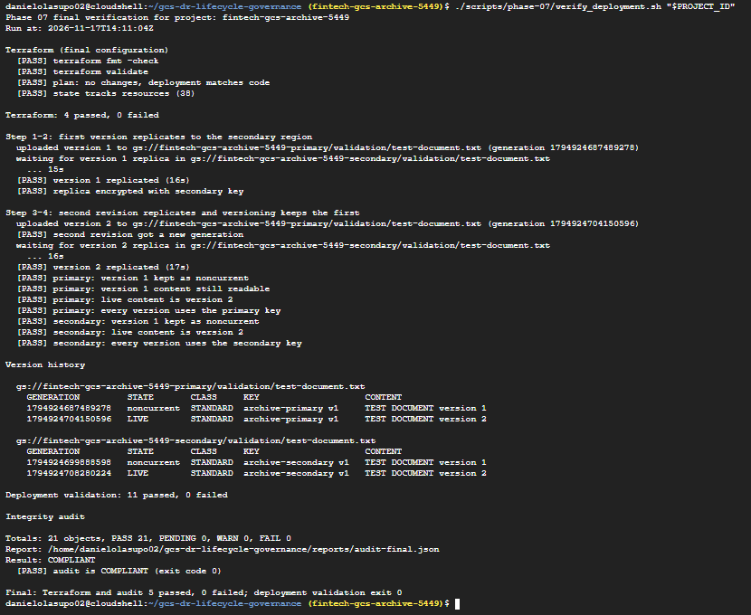
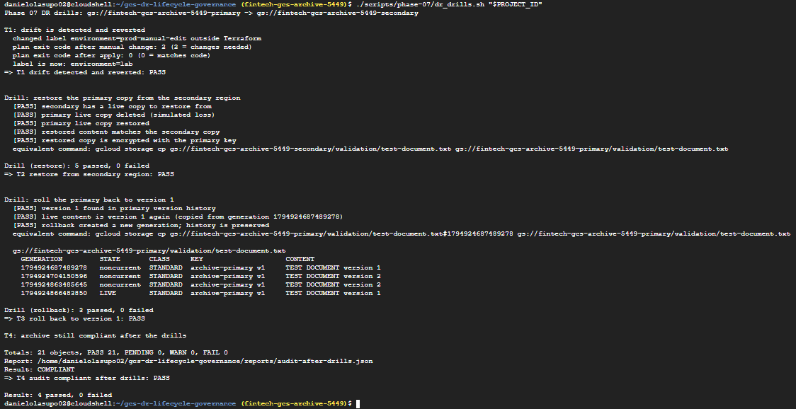

# Phase 7: Deploy and Validate Infrastructure

## Objective
Apply the final Terraform configuration, then prove the archive behaves as
designed with a real test document: it replicates to the secondary region, a
second revision is tracked as a new version in both buckets, and the earlier
version stays recoverable. Finish with recovery drills and a clean, documented
teardown path.

## What Was Built
- `terraform/phase-07`: the final configuration, identical in content to Phase 6, applied with no changes
- `validate_deployment.py`: uploads `validation/test-document.txt` twice and checks replication, versioning and encryption in both regions
- `dr_drills.sh`: four recovery drills: configuration drift, restore from the secondary region, version rollback, and a post-drill audit
- `teardown.sh`: a guarded teardown that handles `prevent_destroy` keys and versioned buckets
- A root `README.md` tying the seven phases together

## Configuration

### Final deployed resources

| Area | Resources |
|---|---|
| Project | 12 APIs (`disable_on_destroy = false`) |
| Storage | Primary bucket (`us-central1`), secondary bucket (`us-east1`): versioning, uniform bucket-level access, public access prevention, soft delete, 4 lifecycle rules each |
| Encryption | 2 key rings, 2 keys (90-day rotation, `prevent_destroy`), CMEK enforcement on both buckets, service agent key grants |
| Replication | Storage Transfer replication job, 4 bucket IAM members, 2 project Pub/Sub IAM members |
| Audit | `storage-auditor` service account, 4 bucket IAM members, 2 key IAM members, 1 impersonation grant |

### Terraform

| Item | Value |
|---|---|
| Working directory | `terraform/phase-07` (final) |
| Files | `versions.tf`, `variables.tf`, `apis.tf`, `kms.tf`, `main.tf`, `replication.tf`, `audit.tf`, `outputs.tf`, `terraform.tfvars.example` |
| State | Copied from `terraform/phase-06/terraform.tfstate` |
| Expected plan | `No changes. Your infrastructure matches the configuration.` |

**Why is "no changes" the right result?** The infrastructure was built phase by
phase. Phase 7 proves the final code describes exactly what is deployed. If the
final plan wanted changes, the code and the cloud would disagree, and the next
`apply` by anyone would change production.

### Validation document

| Step | Action | Proves |
|---|---|---|
| 1 | Upload `validation/test-document.txt`, version 1 | Write path works under CMEK enforcement |
| 2 | Wait for it in the secondary bucket | Replication to `us-east1`, re-encrypted with `archive-secondary` |
| 3 | Upload version 2 of the same name | New generation created |
| 4 | Wait for version 2 in the secondary bucket | Updates replicate, not just new objects |
| 5 | Read version 1 by generation in both buckets | Versioning keeps the earlier revision in both regions |

### Recovery drills

| Drill | Scenario | What happens | Proves |
|---|---|---|---|
| T1 | Someone edits the bucket in the console | Label changed with `gcloud`; `plan` exits 2; `apply` reverts; `plan` exits 0 | Drift is detectable and Terraform is the source of truth |
| T2 | Primary copy lost | Live object deleted; restored from the secondary with a server-side rewrite | Cross-region restore works and re-encrypts with the primary key |
| T3 | Bad revision went live | Version 1 rewritten from primary's own history over the live object | Point-in-time rollback without the secondary |
| T4 | After all of the above | Integrity audit runs as the auditor | The archive is still compliant |

**Why rewrite and not copy for restores?** A restore from the secondary crosses
regions and changes the encryption key. The rewrite API handles both, and
resumes with a token for large objects. The script names the primary key
explicitly, and the primary's enforcement config checks the write like any
other.

### Teardown

`teardown.sh --yes-destroy fintech-gcs-archive-5449`:
1. Applies `force_destroy = true` so versioned buckets can be deleted
2. Removes keys and key rings from state (`prevent_destroy`, and KMS cannot delete them)
3. Runs `terraform destroy` for everything else
4. Schedules every enabled key version for destruction and removes rotation

Key ring and key names stay in the project permanently. Deleting the project
is the full alternative. Teardown is not run as part of validation; the lab
stays up for review, and its running cost is a few cents a month.

### Cost guardrails

| Item | Approximate monthly cost |
|---|---|
| Storage (a few KB of synthetic documents, both regions, all versions) | < $0.01 |
| KMS key versions (2 keys, 1 version each so far) | about $0.12 |
| Replication, Pub/Sub, audits | < $0.01 at lab volumes |

The $10 budget from Phase 1 with alerts at 50/90/100% stays in place.

### Commands
The full command set is in [`scripts/phase-07/`](../scripts/phase-07/):

| Script | What it does |
|---|---|
| [`verify_deployment.sh`](../scripts/phase-07/verify_deployment.sh) | Final Terraform checks, runs the validation document test, then the integrity audit |
| [`validate_deployment.py`](../scripts/phase-07/validate_deployment.py) | Two-version test document: replication, versioning and encryption in both regions, with a version history table |
| [`dr_drills.sh`](../scripts/phase-07/dr_drills.sh) | Drift, restore, rollback and post-drill audit |
| [`dr_drills.py`](../scripts/phase-07/dr_drills.py) | The restore and rollback drills |
| [`archive_lib.py`](../scripts/phase-07/archive_lib.py) | Shared helpers: polling, version listing, rewrite with an explicit key |
| [`teardown.sh`](../scripts/phase-07/teardown.sh) | Guarded teardown; refuses to run without `--yes-destroy <project-id>` matching Terraform |

## Step by Step

```bash
cd ~/gcs-dr-lifecycle-governance/terraform/phase-07
cp ../phase-06/terraform.tfstate . && cp ../phase-06/terraform.tfvars .
terraform init
terraform fmt
terraform validate
terraform plan          # expect: No changes
terraform apply         # expect: 0 added, 0 changed, 0 destroyed
cd ~/gcs-dr-lifecycle-governance
chmod +x scripts/phase-07/*.sh
./scripts/phase-07/verify_deployment.sh "$PROJECT_ID"
./scripts/phase-07/dr_drills.sh "$PROJECT_ID"
```

## Verification

| Check | Command | Result |
|---|---|---|
| Final plan | `terraform plan` | `No changes. Your infrastructure matches the configuration.` |
| Apply | `terraform apply` | `Apply complete! Resources: 0 added, 0 changed, 0 destroyed.` |
| Test document versions | `gcloud storage ls -a gs://fintech-gcs-archive-5449-primary/validation/` | Two generations of `test-document.txt` |
| Replica | `gcloud storage cat gs://fintech-gcs-archive-5449-secondary/validation/test-document.txt` | `TEST DOCUMENT version 2` |
| Full check | `./scripts/phase-07/verify_deployment.sh` | `Deployment validation: 11 passed, 0 failed` and audit `COMPLIANT` |
| Drills | `./scripts/phase-07/dr_drills.sh` | `Result: 4 passed, 0 failed` |

### Screenshots

**Final configuration matches the deployment**


**Test document version history**


**Replication and versioning validated**


**Recovery drills pass**


| File | Capture | 
|---|---|
| `25-terraform-final-no-changes.png` | Terminal: `terraform plan` in `phase-07` ending with `No changes. Your infrastructure matches the configuration.` | 
| `26-test-document-versions.png` | Primary bucket `validation/` folder with **Show deleted data** on, listing both versions of `test-document.txt` | 
| `27-validate-deployment-pass.png` | Terminal: `verify_deployment.sh` from "Step 1-2" through the version history tables for both buckets | 
| `28-dr-drills-pass.png` | Terminal: `dr_drills.sh` showing T1 plan exit codes 2 then 0, the T2 restore checks and `Result: 4 passed` | 


## Decisions

### 1. Validate with behaviour, not just resource existence
A bucket with versioning enabled and a replication job with status `ENABLED`
can still fail to protect data. The validation writes a real document twice and
reads every generation back in both regions.

### 2. Drills restore into the live bucket
Restoring into a scratch bucket would prove the data exists, not that the
production bucket accepts it. Writing back into the primary also proves the
restore passes CMEK enforcement with the primary key.

### 3. The lab stays deployed until review
The deployed cost is cents per month, and reviewers can inspect it. Teardown is
scripted and documented so it is one deliberate command when the time comes.

### 4. Final configuration kept as its own folder
`terraform/phase-07` is the only folder that should be applied from now on.
Earlier phase folders are snapshots for the write-up; their state files are
stale and applying them would roll the deployment back.