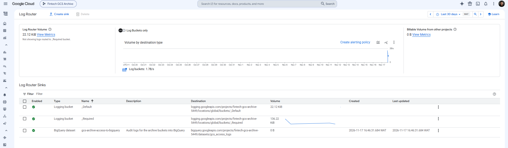
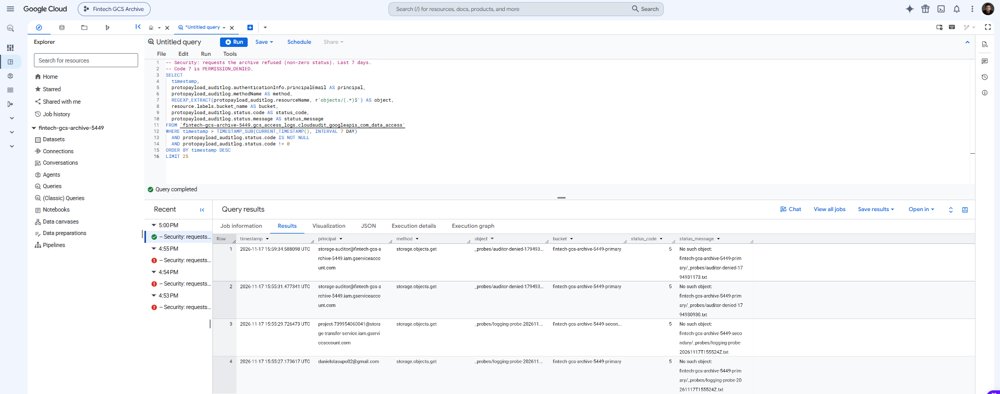
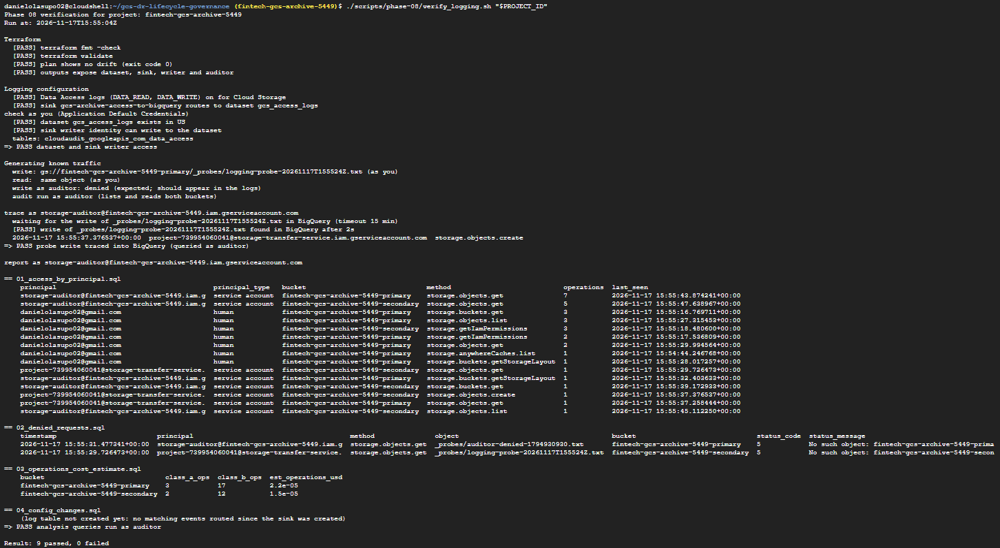
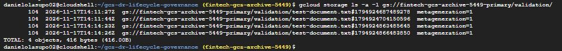

# Phase 8 (Stretch Goal): GCS Access Logs in BigQuery

## Objective
Record every read, write and configuration change on the archive buckets, route
those records into BigQuery, and use SQL to answer the security and cost
questions an auditor or FinOps team would ask: who accessed what, what was
refused, what changed, and roughly what the operations cost.

## What Was Built
- Data Access audit logs (Admin Read, Data Read, Data Write) switched on for Cloud Storage
- A log sink, `gcs-archive-access-to-bigquery`, routing audit logs for the two archive buckets only
- A BigQuery dataset, `gcs_access_logs`, in the `US` multi-region, with date-partitioned tables expiring after 90 days
- Write access to the dataset for the sink's own identity, and read and query access for `storage-auditor`
- Four analysis queries: access by principal, denied requests, operations cost estimate, configuration changes
- An end-to-end check that writes a probe object and finds that exact write in BigQuery

## Configuration

### Log sources

| Log | Default | What it records | Enabled by |
|---|---|---|---|
| Admin Activity | Always on | Bucket and IAM changes: create, update, setIamPolicy | Google, cannot be disabled |
| Data Access: Admin Read | Off | Reading bucket metadata and IAM | `google_project_iam_audit_config` |
| Data Access: Data Read | Off | Object reads and lists | `google_project_iam_audit_config` |
| Data Access: Data Write | Off | Object creates, overwrites and deletes | `google_project_iam_audit_config` |

**Why audit logs and not the older usage logs?** Cloud Storage also has legacy
usage logs, which write CSV files into a bucket. Audit logs carry the
authenticated principal, impersonation chain, caller IP and result code in a
structured form, and route straight to BigQuery without a load job.

### Sink and dataset

| Item | Value |
|---|---|
| Sink | `gcs-archive-access-to-bigquery` |
| Filter | `logName:"cloudaudit.googleapis.com"` AND `resource.type="gcs_bucket"` AND bucket is primary or secondary |
| Destination | `bigquery.googleapis.com/projects/fintech-gcs-archive-5449/datasets/gcs_access_logs` |
| Writer identity | Unique sink service account, `roles/bigquery.dataEditor` on the dataset only |
| Tables | `cloudaudit_googleapis_com_data_access`, `cloudaudit_googleapis_com_activity` (created by the sink on first log) |
| Partitioning | By day (`use_partitioned_tables = true`) |
| Retention | 90 days per partition (`access_log_retention_days`) |
| Location | `US` multi-region |

**Why filter to two buckets?** Data Access logs can be huge. The filter keeps
other buckets' traffic, including Terraform state or logging buckets added
later, out of the dataset and off the bill.

**Why partitioned tables?** One table partitioned by day, instead of a new
table per day, means queries can filter on `timestamp` and only scan the days
they need, and old days expire on their own.

**Why `US` multi-region?** Logs come from buckets in `us-central1` and
`us-east1`. One `US` dataset holds both and keeps the data in the US.

### Access

| Identity | Role | Scope |
|---|---|---|
| Sink writer | `roles/bigquery.dataEditor` | `gcs_access_logs` dataset |
| `storage-auditor` | `roles/bigquery.dataViewer` | `gcs_access_logs` dataset |
| `storage-auditor` | `roles/bigquery.jobUser` | Project (to run queries) |

The auditor can read and query the logs but cannot change them, which T2
proves. Logs that the people being audited can edit are not evidence.

### Analysis queries

| Query | Question | Log table |
|---|---|---|
| `01_access_by_principal.sql` | Who accessed which bucket, with which operation, how often, and when last? Humans and service accounts side by side | Data Access |
| `02_denied_requests.sql` | Which requests were refused, by whom, and why? | Data Access |
| `03_operations_cost_estimate.sql` | How many Class A and Class B operations per bucket, and roughly what they cost | Data Access |
| `04_config_changes.sql` | Who changed bucket or IAM configuration, and when? | Admin Activity |

**What the cost estimate is and is not:** it counts successful operations from
the logs and prices them at Standard-class rates, about $0.05 per 10,000
Class A and $0.004 per 10,000 Class B operations. Nearline and Coldline
operations cost more, and storage, retrieval and network charges are not in
audit logs. It answers "which bucket and which principal drive operation
costs", not "what is the bill". The exact bill comes from Cloud Billing export,
which is out of scope here.

### Terraform

| Item | Value |
|---|---|
| Working directory | `terraform/phase-08` (now the final configuration) |
| New file | `logging.tf` |
| State | Copied from `terraform/phase-07/terraform.tfstate` |
| New resources | 1 audit config, 1 dataset, 1 sink, 2 dataset IAM members, 1 project IAM member |
| New variable | `access_log_retention_days` (1 to 3650) |
| New outputs | `access_logs_dataset`, `access_logs_sink`, `access_logs_sink_writer` |

### Cost guardrails

| Item | Cost |
|---|---|
| Data Access log ingestion into Cloud Logging | Charged per GiB beyond the monthly free allotment; lab volume is a few MB |
| Routing to BigQuery | No routing charge |
| BigQuery storage | Per GB per month; tiny at lab volumes, capped by 90-day partition expiry |
| BigQuery queries | Per TB scanned; the four queries scan kilobytes here |

At archive scale, Data Access logs are the line item to watch: every object
read is a log entry. Options are a narrower sink filter, an exclusion filter
for high-volume service agents such as the replication job, or Data Read logs
only on the primary bucket.

### Commands
The full command set is in [`scripts/phase-08/`](../scripts/phase-08/):

| Script | What it does |
|---|---|
| [`verify_logging.sh`](../scripts/phase-08/verify_logging.sh) | Terraform checks, audit config, sink destination, dataset access, generates known traffic, traces the probe into BigQuery, runs the queries as the auditor |
| [`access_logs.py`](../scripts/phase-08/access_logs.py) | `check`, `trace`, `denied`, `tamper` and `report` against the dataset, optionally as the auditor |
| [`queries/`](../scripts/phase-08/queries/) | The four analysis queries |
| [`failure_tests.sh`](../scripts/phase-08/failure_tests.sh) | Denied write detected, auditor tamper refused, invalid retention rejected |

## Step by Step

```bash
cd ~/gcs-dr-lifecycle-governance
.venv/bin/pip install -r requirements.txt          # adds google-cloud-bigquery
cd terraform/phase-08
cp ../phase-07/terraform.tfstate . && cp ../phase-07/terraform.tfvars .
terraform init
terraform fmt
terraform validate
terraform plan          # expect: 6 to add, 0 to change, 0 to destroy
terraform apply
cd ~/gcs-dr-lifecycle-governance
chmod +x scripts/phase-08/*.sh
./scripts/phase-08/verify_logging.sh "$PROJECT_ID"
./scripts/phase-08/failure_tests.sh "$PROJECT_ID"
```

## Verification

| Check | Command | Result |
|---|---|---|
| Plan | `terraform plan` | `6 to add, 0 to change, 0 to destroy` |
| Sink | `gcloud logging sinks describe gcs-archive-access-to-bigquery` | Destination is the `gcs_access_logs` dataset |
| Tables | `bq ls gcs_access_logs` | `cloudaudit_googleapis_com_data_access` (and `_activity` after any config change) |
| Full check | `./scripts/phase-08/verify_logging.sh` | `Result: 9 passed, 0 failed` |
| Negative tests | `./scripts/phase-08/failure_tests.sh` | `Result: 3 passed, 0 failed` |

The end-to-end trace writes `_probes/logging-probe-<timestamp>.txt` and waits
for a `storage.objects.create` on that exact object to appear in BigQuery. It
proves audit logging, the sink filter, the writer's permission, and the
auditor's read access in one step.

The three negative tests:

| Test | What happens | Expected |
|---|---|---|
| T1 | The auditor tries to upload; then BigQuery is searched for it | A row with the auditor as principal and status code 7, `PERMISSION_DENIED` |
| T2 | The auditor tries to create a table in `gcs_access_logs` | 403; the logs are read-only to the auditor |
| T3 | Plan with `access_log_retention_days=0` | Rejected by variable validation |

### Screenshots

**Log Router sink to BigQuery**


**Denied requests found with SQL**


**Access log analysis report**


**Logging failure tests pass**


| File | Capture |
|---|---|
| `29-log-router-sink.png` | Log Router listing `gcs-archive-access-to-bigquery` with its BigQuery destination |
| `30-bigquery-denied-requests.png` | BigQuery Studio with `02_denied_requests.sql` pasted in (replace `{project}` and `{dataset}`), showing the auditor's refused `storage.objects.create` with status code 7 | 
| `31-access-log-report.png` | Terminal: `access_logs.py report` output from `verify_logging.sh`, showing query 01 (principals) and 03 (cost estimate) | 
| `32-failure-tests-pass.png` | Terminal: `failure_tests.sh` with the T1 denied row and the T2 403 | 


## Notes & Issues

<!--
Record each real problem hit while running this phase, in this shape:

### Issue: <short description>
**Symptom**
```
<exact error output>
```

**Cause:** <why it happened>

**Fix:**
```bash
<what was run>
```

**Lesson:** <what to do differently next time>
-->

## Decisions

### 1. queries as SQL files, not BigQuery views
The sink creates its tables when the first matching log arrives, and a view
cannot be created over a table that does not exist yet. SQL files in the repo
avoid a two-step apply, are reviewed like code, and can be pasted into BigQuery
Studio as they are.

### 2. No CMEK on the log dataset
The dataset holds metadata about access, not documents. CMEK on BigQuery would
need a key in the `US` multi-region and a grant for the BigQuery service agent.
It is the next step for a production deployment where access patterns are
themselves sensitive.

### 3. Audit config managed in Terraform
`google_project_iam_audit_config` is authoritative for Cloud Storage's audit
settings in this project. Turning Data Access logs off in the console would show
as drift on the next plan, the same way the Phase 7 label drill did.

### 4. The cost query is labelled as an estimate
Audit logs see operations, not storage or network. Presenting the number as a
bill would be wrong; presenting it as "which bucket and principal drive
operation counts" is useful and accurate.

### 5. `terraform/phase-08` is now the final configuration
Phase 8 adds resources on top of Phase 7, so `phase-08` replaces `phase-07` as
the only folder to apply. `scripts/phase-07/teardown.sh` points at `phase-08`,
and its `force_destroy = true` step also lets Terraform delete the log dataset
with its tables.


