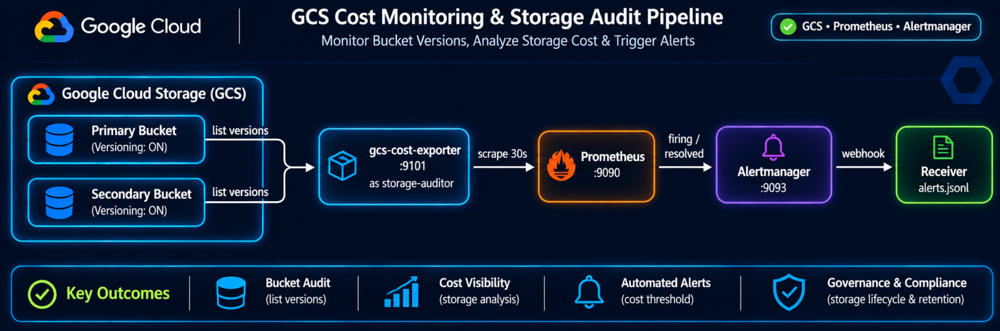
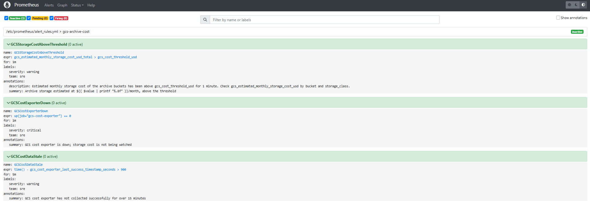
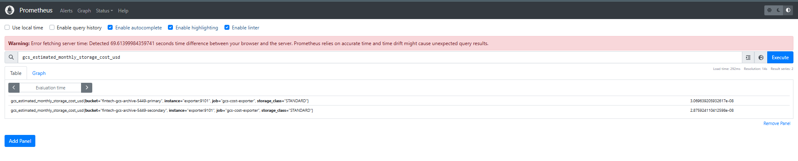
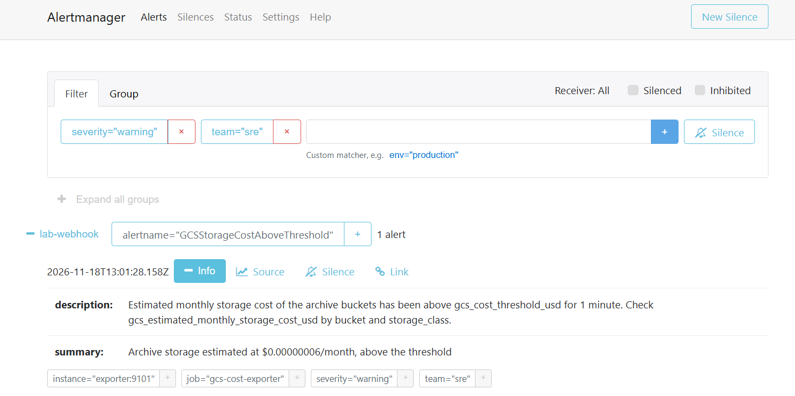
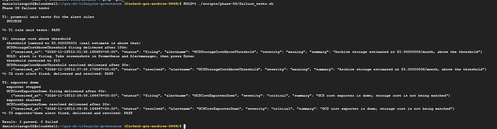

# Phase 9 (Stretch Goal): Storage Cost Alerting with Prometheus and Alertmanager

## Objective
Estimate the monthly storage cost of the archive continuously, expose it as
Prometheus metrics, and raise an alert through Alertmanager when it crosses a
defined threshold. Prove the full path, from metric to delivered notification
and back to resolved, by forcing the alert to fire.

## What Was Built
- `gcs-cost-exporter`, a Python Prometheus exporter that lists every object version in both buckets and prices it by storage class
- Prometheus scraping the exporter, with three alert rules: cost above threshold, exporter down, data stale
- Alertmanager routing alerts to a webhook receiver that logs every notification, firing and resolved
- A Docker Compose stack for all four, started from Terraform outputs
- promtool unit tests for the alert rules
- Live tests that force the cost alert and the exporter-down alert to fire, then resolve

## Configuration

### Architecture

**GCS Cost Monitoring & Automated Alerting Architecture**


### Exporter metrics

| Metric | Labels | Meaning |
|---|---|---|
| `gcs_bucket_bytes` | `bucket`, `storage_class`, `state` | Bytes stored; `state` is `live` or `noncurrent` |
| `gcs_bucket_objects` | `bucket`, `storage_class`, `state` | Object versions stored |
| `gcs_estimated_monthly_storage_cost_usd` | `bucket`, `storage_class` | Bytes priced per GiB-month |
| `gcs_estimated_monthly_storage_cost_usd_total` | | Sum across both buckets |
| `gcs_cost_threshold_usd` | | The alert threshold, from `COST_THRESHOLD_USD` |
| `gcs_price_per_gib_month_usd` | `storage_class` | Prices used, so the estimate is auditable |
| `gcs_cost_exporter_last_success_timestamp_seconds` | | Last successful collection |
| `gcs_cost_exporter_errors_total` | | Failed collections |

**Why list objects instead of using Cloud Monitoring?** Cloud Storage's
`total_bytes` metric is measured once per day and repeated at every sample, so
an alert built on it could lag by a full day. Listing all versions is current
to within the 2-minute collection interval and exact. It also counts
noncurrent versions, which are billed, and which a large overwrite spike would
create. At millions of objects, listing becomes slow; Storage Insights
inventory reports or the daily metric are the scalable sources.

**Why include noncurrent versions?** Versioning is on and old versions are
kept for 90 days. A bulk overwrite doubles stored bytes while live bytes stay
flat. A cost alert on live bytes only would miss exactly that.

**Prices:** approximate US regional list prices, per GiB-month: Standard
$0.020, Nearline $0.010, Coldline $0.004, Archive $0.0012. They are environment
variables, so they can be set for another region without code changes. Soft
deleted bytes, operations, retrieval and network are not included; Phase 8's
query covers operations.

**Identity:** the exporter runs as `storage-auditor` through impersonation. It
can list objects and nothing else, so no new service account or Terraform was
needed for this phase.

### Alert rules

| Alert | Expression | For (lab) | Severity |
|---|---|---|---|
| `GCSStorageCostAboveThreshold` | `gcs_estimated_monthly_storage_cost_usd_total > gcs_cost_threshold_usd` | 1m | warning |
| `GCSCostExporterDown` | `up{job="gcs-cost-exporter"} == 0` | 1m | critical |
| `GCSCostDataStale` | `time() - gcs_cost_exporter_last_success_timestamp_seconds > 900` | 5m | warning |

**Why is the threshold a metric, not a number in the rule?** Changing the
threshold then only needs an environment variable, not a rule edit and reload,
and the current threshold is visible in Prometheus next to the cost. The live
test uses this to force the alert without touching the rules.

**Why the two exporter health alerts?** Without them, a crashed exporter or
broken credentials would look exactly like "costs are fine": no data, no alert.
An alerting pipeline has to alert on its own failure.

**Why 1 minute?** So the tests finish in minutes. In production the cost rule
would use `for: 1h`, so a large one-off upload that is about to be tiered does
not page anyone.

### Alertmanager

| Setting | Value |
|---|---|
| Route | All alerts to `lab-webhook`, grouped by `alertname` |
| Timing | `group_wait 10s`, `group_interval 30s`, `repeat_interval 4h` |
| Receiver | Webhook to `receiver:5001/alerts`, `send_resolved: true` |

The receiver writes one JSON line per notification to
`scripts/phase-09/stack/data/alerts.jsonl`, which is how the tests prove
delivery. Swapping it for Slack or email is a receiver change only.

### Threshold

The default threshold is $10 a month, matching the Phase 1 billing budget. The
two do different jobs: the budget alerts on actual billed spend, days later;
Prometheus alerts on projected storage cost within minutes of the data
changing.

### Running environment

| Item | Value |
|---|---|
| Where | Docker Compose in Cloud Shell (any Docker host works) |
| Images | `prom/prometheus:v2.55.1`, `prom/alertmanager:v0.27.0`, `python:3.12-slim`, exporter built locally |
| Credentials | ADC file (`~/.config/gcloud/application_default_credentials.json`, `chmod 600`) mounted read-only into the exporter; impersonates `storage-auditor` |
| Ports | 9090 Prometheus, 9093 Alertmanager, 9101 exporter (localhost only) |
| Terraform | No changes; `terraform/phase-08` stays the final configuration |

### Commands
The full command set is in [`scripts/phase-09/`](../scripts/phase-09/):

| Script | What it does |
|---|---|
| [`start_stack.sh`](../scripts/phase-09/start_stack.sh) | Writes `stack/.env` from Terraform outputs and starts the four containers |
| [`verify_alerting.sh`](../scripts/phase-09/verify_alerting.sh) | Containers running, exporter healthy, byte count matches `gcloud storage du -a`, target up, rules loaded, nothing firing |
| [`failure_tests.sh`](../scripts/phase-09/failure_tests.sh) | promtool rule tests, forced cost alert, exporter-down alert, each through to delivery and resolution |
| [`stop_stack.sh`](../scripts/phase-09/stop_stack.sh) | Stops the stack |
| [`stack/`](../scripts/phase-09/stack/) | Compose file, exporter, receiver, Prometheus and Alertmanager configuration, rule tests |

## Step by Step

```bash
cd ~/gcs-dr-lifecycle-governance
chmod +x scripts/phase-09/*.sh

# One-off: a credentials file the exporter container can read (see Notes & Issues)
gcloud auth application-default login --no-launch-browser
gcloud auth application-default set-quota-project fintech-gcs-archive-5449
mkdir -p ~/.config/gcloud
cp "$CLOUDSDK_CONFIG/application_default_credentials.json" ~/.config/gcloud/
chmod 600 ~/.config/gcloud/application_default_credentials.json

./scripts/phase-09/start_stack.sh            # threshold $10; rerun in every new Cloud Shell session
sleep 90                                     # first collection and scrape
./scripts/phase-09/verify_alerting.sh
HOLD=1 ./scripts/phase-09/failure_tests.sh   # pauses while the cost alert is firing
./scripts/phase-09/stop_stack.sh             # when finished
```

## Verification

| Check | Command | Result |
|---|---|---|
| Exporter | `curl -s localhost:9101/metrics \| grep ^gcs_estimated` | Cost per bucket and class, plus the total |
| Stack check | `./scripts/phase-09/verify_alerting.sh` | `Result: 11 passed, 0 failed` |
| Failure tests | `./scripts/phase-09/failure_tests.sh` | `Result: 3 passed, 0 failed` |

The three failure tests:

| Test | What happens | Expected |
|---|---|---|
| T1 | `promtool test rules` with synthetic series | Below threshold: no alert. Above: no alert before 1 minute, then firing. Exporter down: firing |
| T2 | Threshold lowered to $0.000000001, then restored | `GCSStorageCostAboveThreshold` firing, then resolved, both delivered to the receiver |
| T3 | Exporter container stopped, then started | `GCSCostExporterDown` firing, then resolved, both delivered |

### Screenshots

**Alert rules loaded in Prometheus**


**Estimated storage cost by bucket and class**


**Cost alert firing in Alertmanager**


**Alerting failure tests pass**


| File | Capture | Link |
|---|---|---|
| `33-prometheus-alert-rules.png` | Prometheus Alerts page listing the three rules, all inactive | Cloud Shell Web Preview, port 9090, path `/alerts` |
| `34-cost-metrics-graph.png` | Prometheus Table or Graph view of `gcs_estimated_monthly_storage_cost_usd` showing each bucket and storage class | Web Preview, port 9090, path `/graph` |
| `35-alertmanager-firing.png` | Alertmanager showing `GCSStorageCostAboveThreshold` firing, taken during the `HOLD=1` pause | Web Preview, port 9093 |
| `36-failure-tests-pass.png` | Terminal: `failure_tests.sh` with the promtool result and the firing and resolved receiver lines | Terminal |

Cloud Shell Web Preview: the eye-shaped button in the Cloud Shell toolbar,
then **Change port**. For `35`, run `HOLD=1 ./scripts/phase-09/failure_tests.sh`,
wait for the `HOLD: alert is firing` prompt, open port 9093 in Web Preview,
expand the `GCSStorageCostAboveThreshold` group, take the screenshot, then
press Enter in Cloud Shell to let the test restore the threshold and finish.


## Notes & Issues

### Issue: verification failed because the stack was not running
**Symptom**
```
Stack
  [FAIL] exporter container running
  [FAIL] prometheus container running
  [FAIL] alertmanager container running
  [FAIL] receiver container running
  [FAIL] Alertmanager ready
...
grep: .../scripts/phase-09/stack/.env: No such file or directory
Result: 1 passed, 10 failed
```

**Cause:** `start_stack.sh` had not run successfully, so there was no `.env`
and no containers. Cloud Shell also stops every container when its VM recycles
after inactivity, so the stack has to be started again in each new session.

**Fix:** Ran `start_stack.sh`, which surfaced the real problem below.

**Lesson:** Verify scripts check what is running now, not what ran yesterday.
In Cloud Shell, starting the stack is the first step of every session.

### Issue: no credentials file for the exporter container
**Symptom**
```
$ ./scripts/phase-09/start_stack.sh
No ADC file at /tmp/tmp.6HRibCNTqI/application_default_credentials.json. Run: gcloud auth application-default login
```

**Cause:** Cloud Shell points `CLOUDSDK_CONFIG` at a temporary folder that is
new in each session. Earlier phases never needed the Application Default
Credentials file there, because Python and Terraform running directly in Cloud
Shell can get credentials from Cloud Shell itself. A Docker container cannot,
so the exporter needs a real credentials file mounted into it.

**Fix:** Logged in to create the file, then copied it to the persistent home
folder:
```bash
gcloud auth application-default login --no-launch-browser
gcloud auth application-default set-quota-project fintech-gcs-archive-5449
mkdir -p ~/.config/gcloud
cp "$CLOUDSDK_CONFIG/application_default_credentials.json" ~/.config/gcloud/
chmod 600 ~/.config/gcloud/application_default_credentials.json
```
`start_stack.sh` now looks in `$CLOUDSDK_CONFIG` first, then
`~/.config/gcloud`, and accepts an `ADC_FILE` override.

**Lesson:** "It works in my shell" does not mean it works in a container on the
same machine. Anything inside Docker only has the credentials that are
explicitly mounted. The copied file is a long-lived credential for my account:
it lives outside the repo, is readable only by me, and is deleted when the
project ends.

### Issue: the byte-count check passed with no data
**Symptom**
```
Exporter
  estimated monthly storage cost: $?   threshold: $?
  [FAIL] cost metric exposed
  [FAIL] last collection succeeded
  [PASS] byte count matches Cloud Storage
```

**Cause:** With no `.env` there were no buckets to measure, and with no
exporter there were no metrics. Both sides summed to 0 bytes, and 0 equals 0.

**Fix:** `bytes_match` now fails if `.env` is missing or the exporter reports
no bytes, before comparing anything.

**Lesson:** The same trap as the Phase 6 checksum issue, from the other side.
A comparison between two empty results is not a pass. Every check needs a
guard that there is something to check.

## Decisions

### 1. Estimate, not bill
The exporter estimates storage cost from bytes and list prices. Billed cost,
with discounts, minimum durations and operations, comes from Cloud Billing and
the Phase 1 budget. The metric is named `estimated` so nobody mistakes it for
the bill.

### 2. Docker Compose in Cloud Shell
The stack is four small containers with no state worth keeping, so it runs
where the rest of the lab runs. It moves unchanged to the home lab Prometheus or
to GKE with the Prometheus Operator; the rules file is the part that carries
over.

### 3. Test the alert path, not just the rule
promtool proves the rule logic. Only forcing a real alert proves Prometheus
evaluates it, Alertmanager routes it, the receiver gets it, and the resolved
notification follows. Both are in the failure tests.

### 4. Prometheus here, Cloud Monitoring alerting in production
In a Google Cloud-only shop, a Cloud Monitoring alert policy on the storage
metrics, or a budget with Pub/Sub notifications, would do this without
running Prometheus. The brief asks for Prometheus and Alertmanager, which also
fits a team that already runs them.